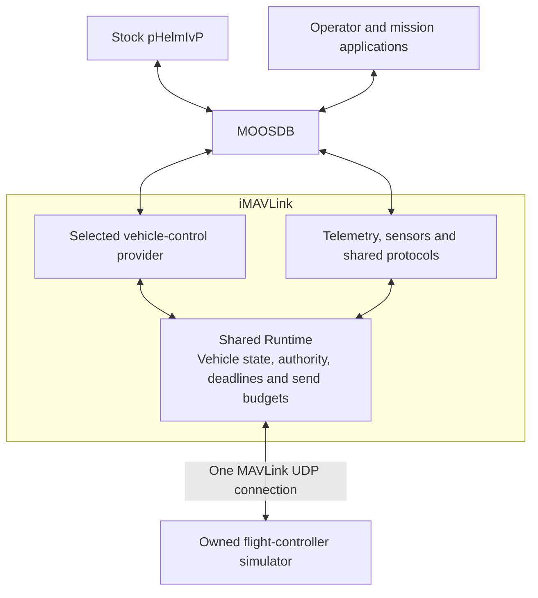
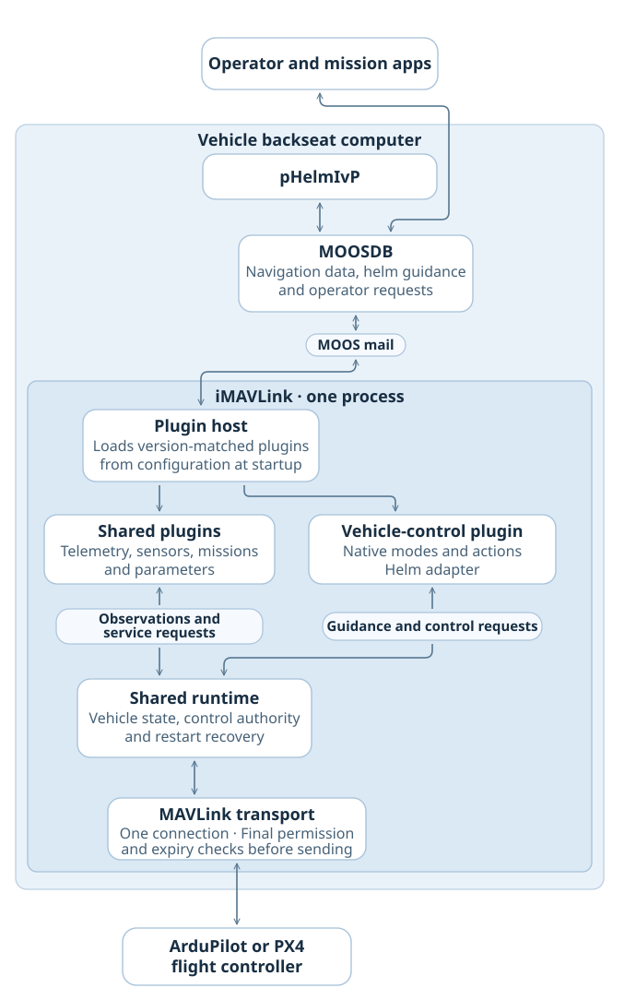

# Current architecture

One iMAVLink app loads providers (plugins) at startup and owns a single MAVLink UDP connection to the local flight-controller simulator. The unmodified IvP Helm (`pHelmIvP`) talks to the bridge through MOOSDB. Receive-only is the default. Shadow mode evaluates guidance without sending it; neither mode sends MAVLink. [Vehicle support matrix](plans/2026-11-06-vehicle-family-coverage/README.md) · [Provider tracker](plugin-progress.md)

## Current capability boundaries

- **Vehicle control.** At most one control provider loads. It groups native operations, direct guidance and stock-helm translation where supported. The selected profile defines the inputs, motion envelope, mode transitions and fallback. [Provider boundaries](decisions/0017-vehicle-providers-and-mission-data.md) · [Control qualification](development/control-qualification.md)
- **Shared capabilities.** Telemetry projects observations into MOOS navigation. Independent providers handle other observations and services such as mission storage, parameters and log retrieval. They share session-bound observations and a bounded protocol budget. Mission storage and mission execution have separate permissions. [Capability map](capability-map.md) · [Mission interface](plugins/missions.md)
- **Host.** iMAVLink owns the socket. Runtime owns authority, queues and final send checks. Providers submit typed work through these services. External modules use a matching development application binary interface (ABI), load at startup and stay resident until process exit. [Final handoff](decisions/0018-observations-and-final-handoff.md) · [External plugin authoring](development/external-plugins.md)

## Helm input and authority

The helm publishes its ordinary course or heading, speed, altitude or depth, state and all-stop variables. The bridge groups eligible fields by arrival and preserves each field's source and age. `ARRIVAL_GROUPED` identifies a bridge cache. It gives no guarantee of one atomic helm solver generation. [Stock helm decision](decisions/0004-use-stock-moos-ivp.md) · [Compatibility design](design/2026-10-29-built-in-modules/stock-helm.md)

The host grants control after an explicit request and fresh profile-specific evidence. Brief normal handoffs may resume within a bounded window. Takeover, restart or an expired recovery window requires explicit reacquisition and fresh inputs. Mode and phase changes can retire old targets, which keep their original deadlines. Runtime checks authority and freshness again immediately before handing bytes to the owned loopback socket. A datagram handed to the OS remains outside the local queue's cancellation boundary. [Policy defaults](decisions/0009-backseat-and-copter-policy-defaults.md) · [Ingress and continuity](decisions/0012-ingress-age-and-owner-continuity.md)

Queue admission, transport handoff, the command acknowledgement (ACK) and observed flight-controller state are distinct outcomes. Verified mission storage can supply proof for an explicit execution request. A durable uncertainty marker fences new effects after restart when a managed native mission may still own the FC. Release requires the profile's observed handback and explicit operator action. [AUTO execution and restart](decisions/0025-external-command-and-auto-restart.md)

For native commands that share a MAVLink command number, delayed ACKs cannot identify an individual MOOS request. The bridge uses fresh vehicle or payload observations for effect confirmation and preserves the original deadline. The command outcome review records the exceptions, restart scope and qualification evidence. Command outcome and authority review

The host reserves discrete vehicle-control request IDs in a private journal before effects. Reservations survive bridge restart on the same route. [Durable control requests](development/control-replay.md)

## Firmware context and qualification

The host observes firmware identity. The capability registry maps declared operations to tests. Qualification attaches to the recorded firmware, frame, scenario, platform and artifacts. The [control qualification guide](development/control-qualification.md) separates generated-wire tests from native behavior evidence. The [local release campaign](development/sitl-release.md) records the software, package and native checks together. [Firmware evidence rules](../config/firmware/README.md) · [Capability registry](../config/capabilities/copter.json)

## MAVMOOS on the backseat computer

The intended deployment puts one iMAVLink host beside stock MOOS-IvP on each vehicle's backseat computer. Matching providers share its authority checks and single flight controller link. Physical transport selection and field testing remain open. [Backseat direction](decisions/0009-backseat-and-copter-policy-defaults.md)

## Design history

The original discussions, [contracts](contracts/README.md) and [decision records](decisions/README.md) preserve proposals and the scope accepted at each stage. The first receive-only implementation and bounded-egress lab retain their own local evidence. The modular Copter workflow records the first native simulation integration.

### Next architecture analysis

The [operating-model traces](research/2026-10-28-operating-models/README.md), [backend assessment](research/2026-10-29-backend-comparison/README.md) and [MAVROS and pArduBridge crosswalk](design/2026-11-05-provider-reference-crosswalk/README.md) capture the earlier source comparisons. The [module sketch](design/2026-10-29-built-in-modules/README.md), [open contract review](research/2026-10-28-contract-priorities/priorities.md) and [initial Copter profile](profiles/2026-10-29-arducopter-draft-01/README.md) retain the proposed interfaces and evidence questions. The prior full overview is available with `git show 3413938:docs/architecture.md`.
