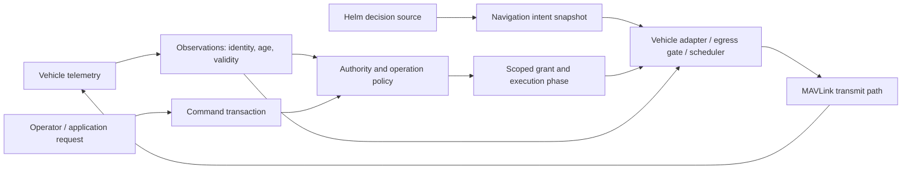

# MAVMOOS contract package: draft-01

Date: October 28, 2026. Status: proposed architecture for review. No contract is accepted or implemented by this package. This is the first draft; predecessor: none.

The package follows the [operating-model comparison and three source traces](../../research/2026-10-28-operating-models/README.md). It specifies semantic obligations before choosing MOOS channels, a wire encoding, a transport library, or a plugin mechanism. Words such as “requires” describe this proposal if adopted; they do not report current MAVMOOS behavior.

## Documents

| Document | Responsibility |
| --- | --- |
| [Shared model](shared-model.md) | Identity, sessions, clocks, freshness, profiles, and the scope of guarantees |
| [Observation contract](observation.md) | What was observed, from whom, in which frame, and with what validity/age |
| [Command-transaction contract](command-transaction.md) | Explicit requests, replay handling, protocol outcomes, observations, and completion |
| [Navigation-intent contract](navigation-intent.md) | Coherent, expiring navigation decisions and adapter/scheduler admission |
| [Authority contract](authority.md) | Which source may cause which bridge transmissions, with handoff and revocation semantics |
| [Open questions](open-questions.md) | Stable question IDs, candidate recommendations, evidence needed, and consequences |
| [Review scenarios](review-scenarios.md) | Cross-contract walkthroughs and future acceptance criteria; no executed tests |

## Proposed responsibility boundaries

This is a logical diagram, not a selected class/thread/process layout. Observations do not grant control. A command request does not declare itself successful. A navigation snapshot does not acquire authority by arriving. Grant state is owned by the bridge; publishing a requested state cannot promote it to an active grant.

## Recommended draft positions

- Canonical observations and intent carry explicit meaning and provenance; convenient NAV/DESIRED scalar compatibility is an adapter concern.
- Side-effecting commands have issuer-supplied request identity, receiver/session binding, expiry, and duplicate semantics. A retained boolean is insufficient as the canonical request.
- Continuous navigation uses complete, versioned snapshots rather than a silent merge of independently renewed quantities.
- Source freshness and downstream transmission cadence are independent. A relay cannot extend original validity by assigning a new receive timestamp.
- Authority is scoped to the bridge's own operation classes and transmit paths. External RC/GCS/FC actions remain independent and must be observed where possible.
- An authority handoff has a bounded preparation phase. Any pre-entry stream needs its own profile-defined permission and target semantics.
- Invalidating a grant prevents subsequent eligible enqueue/dequeue work; it cannot recall bytes already sent. Transport residuals are a qualification question, not a hidden guarantee.

These are recommendations in this draft. [Open questions](open-questions.md) identify where a position still needs evidence, a policy choice, or an implementation feasibility assessment.

## Readiness and scope

The documents can be reviewed now. None authorizes a vehicle profile for execution. A future implementation must resolve the applicable freshness/trust mechanism, replay/session behavior, coherent helm interface, adapter semantics, authority/failure transitions, and egress timing bounds before claiming that profile is ready.

No default safety timeout, fallback flight mode, gain, autopilot release, physical-identity guarantee, serialization, or cryptographic mechanism is selected. References to a profile mean a future versioned specification, not a profile that already exists.

## Evidence map

| Source finding | Draft consequence |
| --- | --- |
| [Telemetry trace](../../research/2026-10-28-operating-models/trace-01-position-telemetry.md): cached attitude, conditional timestamps, separate MOOS scalar publication | Observation time/validity and derived-data provenance must be explicit |
| [Command trace](../../research/2026-10-28-operating-models/trace-02-acknowledged-command.md): different send/ACK/state contracts; retained MOOS request values | Operation-specific result semantics, replay controls, and explicit uncertainty |
| [Setpoint trace](../../research/2026-10-28-operating-models/trace-03-continuous-setpoints.md): callback versus scheduled streams; separate scalar accesses; all-stop and broker renewal | Coherent expiring intent, phase-aware authority, and independent scheduler/freshness checks |
| [Operating-model comparison](../../research/2026-10-28-operating-models/operating-model-comparison.md): helm/control/hardware boundaries differ | Vehicle adapters and scoped execution profiles; no universal controller or fallback |

Source claims remain tied to the study's pinned evidence. New requirements here are design proposals, not deductions that the existing projects already satisfy them.
