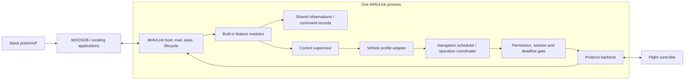

# One application, built-in plugins, stock helm

October 29, 2026. **Proposed architecture sketch; documentation only.** The user requested this design basis and explicitly ruled out helm changes. [Decision 0004](../../decisions/0004-use-stock-moos-ivp.md) records the accepted stock-MOOS-IvP constraint. Interface names, lifecycle details, dependency choices, profiles and timing budgets below remain review proposals. No application code, build files, dependencies or runnable missions were added.

## 1. Shape of the application

Tentative executable name: `iMAVLink`. One MOOS client/application owns a built-in registry of feature factories. Configuration selects which compiled-in modules are instantiated. There is no shared-library discovery, ROS executor requirement or runtime plugin ABI in this sketch.

Arrows describe responsibilities, not dedicated threads. Backend callbacks and MOOS mail feed a bounded ingress path; one logical owner serializes state updates and plugin callbacks. I/O and operation workers may exist, but do not directly mutate that state. Their final controllable send boundary must honor current permission/deadlines. Exact scheduling and library feasibility remain open.

## 2. Responsibilities

| Component | Owns | Does not decide |
| --- | --- | --- |
| App host / registry | Configuration, factory selection, dependency checks, MOOS registration/publication, lifecycle, ingress dispatch | Vehicle control law or automatic arming policy |
| Vehicle context / observation store | Configured target, local connection/session generation, immutable read views, per-observation age/validity | Which mission behavior should run |
| Control supervisor | Local navigation permission, inhibition/re-enable conditions, selected producer, current guards | Global ownership of RC/GCS paths outside the bridge |
| Transaction coordinator | Admission/deduplication, operation ordering, results and uncertainty | That a queued/ACKed request has physically completed |
| Navigation scheduler | Latest eligible target plan, cadence/deadline checks and miss reporting | Renewing an old helm input because it sent again |
| Vehicle adapter | Quantity/frame/vertical/facing semantics, conversion and owned loops, mode/prerequisite requirements, loss-response plan | Granting itself permission or bypassing egress |
| Protocol backend | Selected SDK/transport integration, received events, bounded submission/completion interfaces and declared queue/cancel capabilities | Extending application validity or treating reconnect as new permission |

The registry instantiates feature classes. The vehicle adapter and backend are separate strategy interfaces; they need not inherit the feature-plugin base. Their selection can also use built-in factories. No transport library has been selected.

## 3. Candidate built-in features

| Module ID, illustrative | Main role | Dependencies / boundary |
| --- | --- | --- |
| `vehicle_status` | Interpret target identity, heartbeat/mode/armed/link evidence and feed the shared store | Required whenever an enabled effect needs those observations; it is not an optional permission bypass |
| `telemetry` | Normalize navigation/sensor observations and publish documented MOOS projections | Shared target context; unknown sample time remains unknown |
| `commands` | Parse operation requests and report transaction progress/results | Transaction coordinator and operation-specific permission/prerequisites |
| `parameters` | Parameter query/update protocol and MOOS results | Read and write have distinct operation semantics/scopes |
| `missions` | Mission transfer/progress operations | Mission lifecycle/conflict rules; helm navigation permission is not a universal feature-enable flag |
| `helm_compat` | Consume stock scalars/state/all-stop; maintain per-field metadata and produce a candidate input set | Selected producer, stock compatibility profile, vehicle adapter and control supervisor |
| `diagnostics` | AppCast and machine-readable as-of/blocked-reason/module health summaries | Host status; diagnostic text is not a command result or permission |

This is an organizational inventory, not a first-release implementation commitment. Enabling a module requires its dependencies and supported backend/profile capabilities. Disabling helm support leaves eligible telemetry, parameter and command functions usable under their own policies.

## 4. Interfaces and flows

- [Interface sketch](interfaces.md): lifecycle, data records, effect proposals, backend and vehicle-adapter boundaries.
- [Data flow and lifecycle](data-flow.md): startup, telemetry, operations, navigation, concurrency and teardown.
- [Stock helm compatibility](stock-helm.md): exact inputs, permission/age handling, all-stop/restart rules and limitations.

The central rule is **modules propose; the host commits state and authorizes effects**. A plugin callback does not directly call an unrestricted SDK command. Built-in modules are trusted code in the same process; this API boundary is not a security sandbox.

## 5. What we borrow from MAVROS

The pinned ROS 2 MAVROS host constructs plugin instances through factories, registers message-ID interests, supplies shared UAS context and keeps feature state inside module objects. We borrow that organization. We replace its dynamic pluginlib/XML discovery with a compiled registry and ROS topic/service glue with the MOOS boundary. We do not copy its executor or assume each plugin needs a thread or connection.

MAVROS references: [factory interface](https://github.com/mavlink/mavros/blob/2d3f4db1101c7950c8817a9d788f0d11106fb261/mavros/include/mavros/plugin.hpp#L294-L317), [instance creation/registration](https://github.com/mavlink/mavros/blob/2d3f4db1101c7950c8817a9d788f0d11106fb261/mavros/src/lib/mavros_uas.cpp#L319-L400), [message dispatch](https://github.com/mavlink/mavros/blob/2d3f4db1101c7950c8817a9d788f0d11106fb261/mavros/src/lib/mavros_uas.cpp#L261-L270). The prior 19-file source manifest pins the bytes. pArduBridge contributes separation of MOOS/model state, operation policy, results and discrete takeover versus ongoing streaming; comparison.

Stock behavior is grounded in the inspected MOOS-IvP revision `023fb54e00692611ecee2cd6f1138d10eec2127e` and independently pinned Core MOOS, not an assumed changed helm. The [evidence index](../../research/2026-10-28-contract-priorities/evidence.md) and source manifest record those revisions/hashes. The archived MIT helm chapter, numbered extraction lines 459–479 and 585–623, supplies journal/heartbeat and delayed-primary context; source inspection supplies exact publication order and all-stop details beyond that manual.

## 6. Choices still needed before implementation

The subsequent [initial ArduCopter profile](../../profiles/2026-10-29-arducopter-draft-01/README.md) now proposes control quantities, observed-state guards, candidate timing and loss handling for one already-airborne Guided workflow. Those choices refine this sketch for review; firmware/backend/envelope selection and execution qualification remain open.

The later [backend comparison](../../research/2026-10-29-backend-comparison/README.md) maps those needs to MAVSDK, libmavconn and direct MAVLink. It recommends host-owned navigation/retry policy and an explicitly qualified transport gate, without selecting a dependency. Its [criteria and paper cases](../../research/2026-10-29-backend-comparison/requirements-and-review.md) specify the remaining evidence/settlement questions.

The [UDP queue assessment](../../research/2026-10-29-udp-queue-assessment/README.md) now sketches that controlled boundary, including libmavconn FIFO retrofit/bypass alternatives and an owned UDP candidate. Its preference is conditional on a configured single-peer first link; it does not choose an execution platform, dependency or accepted API.

The [phased plan](../../plans/2026-10-29-direct-udp-copter/README.md) uses this organization for a small first slice. Begin with private status/telemetry and transport boundaries; add control/helm features when their gates need them. The entire illustrative registry/interface inventory is not an implementation prerequisite, and a second backend or runtime loader is not required to demonstrate the seam.

1. First vehicle/autopilot release and control quantities; required observations, owned loops and units/references.
2. Exact MOOS names/encoding for operator requests, results and status. Existing helm output names are inputs, not a new helm schema.
3. Age/skew/cadence/queue bounds and qualification of the intended MOOS clock/topology assumptions.
4. Gap/all-stop/override/restart response and whether any transient recovery can resume under an existing permission.
5. Backend dependency and achievable final-gate/cancellation/residual behavior, including hidden retries.
6. Typed C++ data representations, dependency versioning, error handling and memory/queue resource bounds.

No numeric defaults, firmware support, hard real-time guarantee, dynamic plugin ABI or claim of compliance with draft-01's stronger navigation contract follows from this sketch.
