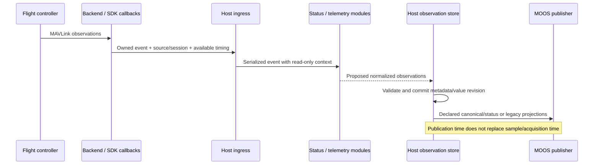
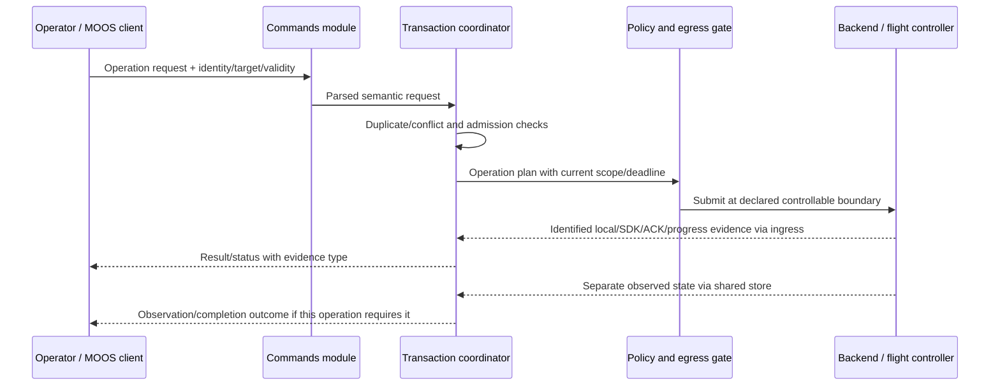

# Data flow, scheduling, and lifecycle

October 29, 2026. Proposed flow sketch; no implementation, runnable scenario or timing validation. [Interfaces](interfaces.md) and [stock-helm rules](stock-helm.md) define the referenced objects.

## 1. Startup and feature selection

1. Read bridge configuration and the selected execution profile. Resolve the configured vehicle/producer bindings, module list and namespaces; start with navigation inhibited.
2. Create core stores/coordinators, one backend adapter and the selected vehicle adapter. Create enabled feature objects through the compiled registry. This is object construction, not XML/shared-library discovery.
3. Configure modules and collect binding plans. Check dependencies, capabilities, duplicate publication owners, supported quantities and required policy fields. Missing required control/profile/backend support cannot be silently ignored.
4. Register the union of declared MOOS inputs and connect backend event dispatch. Both receive paths enqueue owned event data with ingress/receipt metadata; plugins do not retain pointers into temporary mail or transport buffers.
5. Start modules and the configured link. Receive status/telemetry, populate the observation store and publish as-of readiness. A connected link alone does not permit any navigation.
6. An explicit enable/acquisition request establishes a pending local control context. Require the profile's current FC/state/clock guards and qualifying post-boundary stock publications before navigation becomes eligible. Retained registration data cannot bypass this step.

Where FC entry requires preparation traffic, the host coordinates only the profile's separately bounded preparation scope before final mode confirmation. That sequence/target remains to be specified per FC; it does not authorize ordinary navigation or assume preparation is motion-free.

Read-only and independently permitted features can remain useful while navigation is inhibited. An absent vehicle/profile can be reported as unavailable rather than fabricated as a supported control configuration.

## 2. Incoming telemetry



For SDK-decoded events, retain whatever timing/provenance the SDK actually exposes. For raw-message interests, a feature decoder can construct the observation proposal. The host normalizes ownership/target metadata and commits it; the backend/SDK version determines which source information is available. Do not invent missing sensor time, covariance or identity proof.

Critical mode/armed/link observations feed control guards independently of optional NAV projection publication. A mutex-consistent in-memory view is not proof that all sensor quantities were measured simultaneously. Derived observations retain parent-age/skew requirements where their profile needs them.

## 3. Discrete commands and results



The diagram's return arrows traverse host ingress/serialized processing; backend threads do not directly mutate transaction or MOOS state. Operations that do not have an ACK or completion predicate cannot claim one. Timeout after possible handoff records uncertainty; history queries and duplicate requests do not resend automatically.

Observation wait is asynchronous state, not a future that blocks the plugin callback or navigation tick. Conflicting mode/mission/navigation effects need an operation-specific conflict policy. An application request ID does not imply the FC echoes that ID; wire correlation remains the selected protocol module's responsibility.

## 4. Stock helm to continuous targets

```mermaid
sequenceDiagram
  participant H as Stock pHelmIvP
  participant D as MOOSDB / host ingress
  participant C as Helm compatibility module
  participant S as Host supervisor
  participant A as Vehicle adapter
  participant E as Scheduler and egress
  participant B as Backend / FC
  H->>D: Existing DESIRED_* / state / all-stop messages
  D->>C: Owned mail batch with original metadata
  C-->>S: Field updates, state/inhibition evidence
  S->>S: Commit batch; apply inhibition before eligibility
  S->>A: Eligible ARRIVAL_GROUPED input set + current observations
  A-->>E: Profile-specific target plan + fixed deadline/bindings
  loop while input and permission remain eligible
    E->>E: Recheck age, observations, permission and generation
    E->>B: Submit current target at declared final gate
  end
  H->>D: Non-clear all-stop, loss or override evidence
  D->>S: Invalidate candidate / apply profile recovery rule
  S->>E: Invalidate controllable old navigation work
  Note over E,B: Already handed-off work remains residual uncertainty
```

The adapter can recompute a target using current observations while the same helm fields remain eligible, for example if a selected profile owns feedback. Such recomputation never renews the original field deadlines. Latest-plan replacement avoids an unbounded FIFO of old navigation targets; discrete transactions use their separate ordered/conflict-controlled path.

The scheduler does not enter Guided on every tick, select the active helm by arrival order, turn all-stop zeros into a generic action, or force mode reacquisition after external override. Any entry/preparation/release operation is a separately permitted profile action with current prerequisites. No universal mode/target is specified here.

## 5. State ownership and scheduling order

One logical state owner executes the following phases. Its exact mapping to MOOS Iterate versus another host-owned execution loop remains a feasibility choice; MOOS callbacks may enqueue without owning mutable module state.

1. Drain a bounded ingress budget, giving disconnect/inhibition/control-state events priority. Preserve whole-mail-batch processing boundaries for eligibility evaluation.
2. Invoke interested modules and stage their effects. Reject events for obsolete connection/target generations. Apply observations and input/state updates without recursive plugin calls.
3. Process known inhibitions and pending permission/transaction changes. Within a turn, a recognized negative control event wins over forming a fresh-looking navigation plan.
4. Run due nonblocking plugin/coordinator work against an immutable current view. New proposals cannot mark themselves authorized.
5. Evaluate current prerequisites and adapter plans; select the latest eligible navigation target and due admitted operations.
6. At each last controllable submission/dequeue boundary, recheck current binding, permission revision and monotonic deadline with defined ordering relative to invalidation. Emit diagnostic/result evidence from the actual boundary reached.

The owner performs no blocking SDK calls. Workers perform approved protocol work and return identified events. A worker holding an old authorized object must still honor invalidation/deadline at its applicable gate; a shared process does not make that ordering automatic.

Queue bounds, publication coalescing and work budgets need implementation choices. Telemetry drops/coalescing must report gaps where relevant. If control-state loss or overflow prevents the host from knowing current eligibility, inhibit that path; do not silently discard an all-stop while continuing fresh-looking scalars. Overload/delay must not reset receipt times when events are finally processed.

Requested AppTick/CommsTick and a background sender do not establish hard latency bounds. Every actual effectful send checks its deadline even without new mail. A required loss-response action needs a wakeup/lateness budget as well; the sketch promises no measured cadence or residual bound.

## 6. Disconnect, restart, and shutdown

Revoke the relevant local permission first, invalidate old controllable navigation/operation work, clear input readiness and move the affected binding to a new local generation. Keep old transaction results as history/uncertainty where applicable; do not accept late callbacks as permission to resume. Known loss of vehicle continuity requires a new target context rather than quietly rebinding old work.

If the profile requires a release/failure action and fresh prerequisites permit it, the host may run a separately bounded response operation. It does not run under the revoked navigation permission or automatically renew old helm input. If that response is unspecified/unavailable, report the limitation; no disarm/Hold fallback is invented.

Stop effectful admission, reconcile/report remaining work up to the declared shutdown boundary, close backend I/O, drain or discard obsolete-generation callbacks under a stated policy, then stop/release module objects. This cannot recall already transmitted packets or stop an SDK's hidden retry queue without demonstrated backend support. Shutdown/destructor behavior needs to be checked for the selected library before making a stronger claim.

## 7. Paper walkthroughs for interface review

These are expected design outcomes, not executed tests:

| Case | Expected outcome under the proposed interfaces |
| --- | --- |
| Disable `helm_compat`, retain telemetry/parameter query | Those features can operate under their own policy; navigation remains unavailable |
| Enable a feature with a missing required status/profile capability | Reject configuration or advertise the effectful capability unavailable; no silent bypass |
| New heading and old speed arrive together | Local cache can be read consistently; no same-cycle claim. Each required field must meet its own deadline |
| DRIVE heartbeat stays current while required scalar input expires | Navigation becomes ineligible; heartbeat does not renew fields |
| All-stop and fresh zero scalars arrive in one input turn | Inhibition takes precedence; no generic zero-vector/disarm action |
| Reconnect delivers retained fields/clear status | Data may inform diagnostics/state, but cannot bypass explicit enable and qualifying post-boundary updates |
| Same numeric values receive genuine new stock publication timestamps | May refresh individual publication evidence; never gains a solver-generation certificate |
| Late SDK result refers to old control/connection generation | Update permitted historical evidence only; do not re-enable current navigation |
| Queue/control-state continuity is lost under overload | Inhibit the affected path and report loss; no fresh receipt time manufactured at drain |
| Grant expires after enqueue, before controllable handoff | Final gate rejects old work; any already escaped work is reported as residual |

Later implementation validation must identify backend/FC versions, selected profile/topology and observed boundaries, rather than treating these paper outcomes as completed tests.
