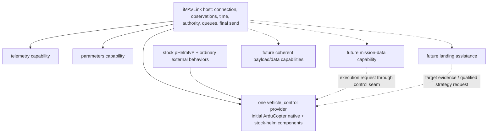

# Capability boundaries across the plugin inventory

November 4, 2026. Source-review baseline: **`11dc5c308ba8db2140589d1e41f8477cd427062d`**, initially clean. The initial sections recommend architecture and a structural first increment; later sections record the subsequently authorized implementation and frozen-source audit. Candidate functionality remains a design inventory, not promised delivery. Stock pHelmIvP remains unchanged. Receive-only defaults, explicit owned simulator routes and the exclusion of real vehicles/hardware remain intact.

## Recommendation

Organize selectable features around a coherent responsibility that an operator can understand. Keep related native-FC and helm-driven ways of controlling the vehicle within one **vehicle-control capability**, with explicit strategies and different semantics where necessary. This principle applies to the whole inventory: it is not a proposal for a special Loiter plugin.

The immediate refactor should replace the separate deployed `commands` and `helm` modules with one actual control module containing small, independently testable components. An initial provider named `arducopter_control` is appropriate because the delivered control policy is Copter-specific. Its public role should be `vehicle_control`; the provider/profile identifier answers *which implementation*, while the role answers *what capability*. A future Rover or PX4 provider can implement that role without putting every MAVLink feature inside an ArduCopter class. A generic `control` filename plus an explicit Copter profile would also be coherent, but both selection mechanisms are unnecessary for the first implementation.

Keep telemetry and parameters independently loadable. Keep transport, clocks, the vehicle context, authority, original deadlines, bounded scheduling and final send authorization in the host. A serializer, watchdog, ACK tracker, coordinate transform or private behavior adapter does not need its own loadable plugin. Conversely, a camera, mission-transfer service or parameter client should not require loading all vehicle-motion functionality.

This agrees with the [runtime/profile seam review](runtime-review.md). The migration and acceptance inventory belongs in the companion migration review. The first implementation should preserve existing MOOS requests and behavior while changing ownership and packaging; a new unified request schema is not required to make the boundary coherent.

## What exists at the reviewed baseline

The four produced shared libraries are `telemetry`, `commands`, `helm` and `parameters`; this is explicit in [the plugin CMake file](../../../src/plugins/CMakeLists.txt), lines 5–22. Their present names describe a mixture of operator functionality, input source and protocol machinery.

| Delivered surface | Actual responsibility at `11dc5c3` | Boundary implication |
| --- | --- | --- |
| `commands` | Seven named actions: arm, disarm, takeoff, native hold, land, RTL and Guided; command/ACK lifecycle and observed completion | This is an initial Copter lifecycle/control component, not a general implementation of every MAVLink command. |
| `helm` | Stock scalar/state/all-stop adapter, source/publication-age checks, acquisition, bounded handoff, latch/reset and operator readiness | It is an alternate motion-input path inside the same control capability. It is not an IvP solver or a behavior loader. |
| `telemetry` | Conventional NAV projection, MOOSGeodesy, altitude/course/heading distinctions and validity metadata | It is a useful read-only capability independent of motion control. Raw decoding/report storage already lives below it. |
| `parameters` | Named reads, paced indexed inventory, complete MOOS snapshot, restricted simulator SET/echo/readback; explicit streamed ground-bench alternative | This is an independent protocol capability, with its own operation lifetime and resource policy. |
| Host/runtime | Connection/store/owner timing, permission and resume permits, external command leases, queues, control encoding and final guards | Keep common authorization here; extract the Copter interpretation currently mixed into this layer. |

These facts come from baseline `CommandPlugin.cpp`, lines 62–80 and 127–171 (now [CopterCommands.cpp](../../../src/libmavmoos_control/CopterCommands.cpp)); baseline `HelmPlugin.cpp`, lines 19–32 and 46–94 (now [HelmAdapter.cpp](../../../src/libmavmoos_control/HelmAdapter.cpp)); [TelemetryPlugin.cpp](../../../src/plugins/TelemetryPlugin.cpp), lines 30–100; [ParameterPlugin.cpp](../../../src/plugins/ParameterPlugin.cpp), lines 76–128 and 218–327; and [Runtime.cpp](../../../src/libmavmoos_runtime/Runtime.cpp). The concrete Copter leaks and exact ownership moves are tabulated in the runtime review. Use the Git command below for the exact pre-refactor source; current file links aid navigation after the move.

The ordinary demonstration mission already composes `BHV_Waypoint`, `BHV_StationKeep` and the existing external `BHV_ConstantAltitude` behavior ([mission source](../../../missions/copter_sitl/meta_vehicle.bhv)). MAVMOOS consumes their resulting ordinary helm outputs. That is different from implementing a new public bridge action that creates a helm loiter/return/landing plan. Such an action must not be advertised as delivered merely because the generic helm path can carry its eventual outputs.

The broad [capability map](../../capability-map.md) remains the inventory of future candidates. Its references to mission transfer, manual/RC, landing targets, cameras, gimbals, files and other vehicles are not implementations. The existing [reference archive](../../references.md) and [MAVROS/plugin analysis](../../research/2026-10-29-design-clarifications-and-plugins.md) supply hosting and microservice precedents; this review does not claim a new inspection of every MAVROS plugin or MAVROS parity.

pArduBridge remains useful precedent for a coordinated UAV workflow with reusable lower-level services. At the locally checked reference `e34a62ef49c2be42215a69c351850cbd85881486`, [`UAV_Model.cpp`](https://github.com/cbenjamin23/moos-ivp-uav-base/blob/e34a62ef49c2be42215a69c351850cbd85881486/src/pArduBridge/UAV_Model.cpp#L137-L142) constructs MAVSDK MissionRaw, Action and Param objects in the same model; its later operation paths use those services. These are library API components, not a requirement for a separate MAVMOOS loadable plugin for every action. MAVROS's separate command/setpoint examples likewise provide reusable hosting/protocol patterns without prescribing the final MOOS operator-facing grouping.

## Public capability, provider and private component

These three levels should be visible in the design without forcing three registries:

1. **Capability:** the operator-facing responsibility, such as vehicle control or parameters. Documentation groups its related actions and alternatives together.
2. **Provider/module:** the selectable startup-loaded implementation, such as the initial ArduCopter control provider. It declares its role, profile, enabled paths and dependencies. Only one provider may own vehicle control for a bound vehicle.
3. **Component:** ordinary C++ code used inside a provider or host, such as command tracking, stock-helm parsing, Copter translation and parameter table accounting. Components can have separate source files/tests without becoming deployment choices.

The distinction avoids two failures. Exposing every helper as a plugin makes users assemble implementation details and creates competing control paths. Putting everything into an `FC` plugin makes read-only/protocol features depend on a motion controller and hides vehicle differences. The present four-library structure is an implementation checkpoint, not a permanent taxonomy.

For the first control provider, private components can remain recognizable: `CommandTransactions`, `StockHelmAdapter`, and a Copter control profile/backend. One facade owns the public subscriptions and their coordinated lifecycle. It should not be two independently loaded plugins hidden behind a cosmetic name. Their existing unit tests can continue exercising the components directly, while integration tests load the real combined module.

## Proposed inventory and future growth

The table specifies ownership, not an instruction to create every row now. Only telemetry, parameters and the current native/helm control subset have delivered code. All new feature rows below remain **candidates** until a concrete scope and acceptance criteria are selected.

| Capability family | Public responsibility and related alternatives | Loadable ownership / shared dependency | Current versus future |
| --- | --- | --- | --- |
| Vehicle control | Lifecycle, acquisition/release, native FC motion actions, stock-helm motion and future qualified input strategies | One control provider for the bound vehicle; common host authority and scheduling | Combine the existing command/helm subset now. New goto/orbit/return/landing strategies remain candidates. |
| Vehicle telemetry | Position/velocity, attitude, GPS/home/altitude, system/battery/RC observations, frames and validity | One telemetry capability with private report/projection components and selectable streams | Current five raw families/NAV subset exists. Additional reports do not each require another shared library. |
| Parameters | Read/inventory/write/metadata/value verification, with firmware encoding and transfer policies | Independent parameter module; shared target context, protocol traits and bounded parameter lane | Current restricted ArduPilot simulation subset exists. General writes, alternate encodings and richer metadata remain candidates. |
| Mission/fence/rally data | Upload/download/validate/store/observe indexed objects and progress; related protocol object kinds | A coherent mission-data module can share transfer accounting internally. It does not become a second motion controller. | Transfer/execution interfaces are candidates. No current upload or mission start is implemented. |
| Mission execution | Native FC execution of a qualified stored mission, or an external MOOS mission producing ordinary helm intent | Motion ownership stays with the sole control capability. A future mission-data workflow may request execution through a typed control seam. | The external stock-helm route works. Native mission execution and automatic conversion/loading of MOOS missions do not. |
| Landing assistance | Target acquisition/quality/frame handling and precision-landing target feeds; optional assistance for a qualified landing strategy | Standard LAND remains control. An optional landing-assistance module supplies target evidence/streaming and collaborates with control. It cannot acquire independent motion authority. | Standard Copter LAND exists. LANDING_TARGET support, precision-landing workflows and helm-assisted approaches remain candidates. |
| Imaging payloads | Camera operations, gimbal pointing, trigger/capture/status and coordinated imaging workflows | A payload capability can group a useful device/workflow family. Split camera/gimbal providers later only when independent lifecycles or consumers justify it. | Candidates. Body-yaw demands go through control rather than bypassing it through a payload command. |
| Other actuated payloads | Gripper/winch or another independently meaningful payload family | A dedicated coherent payload provider when needed, reusing command/protocol services | Candidates. Do not hide arbitrary actuator commands in a generic vehicle-control command bag. |
| External sensors/navigation | Range/obstacle, vision/odometry or other external observation integration, with frames, source and age | Optional capability modules for an actual sensor-integration use case; raw codec/frame/time helpers stay private/shared | Candidates. Receiving a report is distinct from permission to inject estimator or obstacle data into an FC. |
| Files and logs | Bounded vehicle-data retrieval/upload, paths, progress, cancellation and payload delivery | A data-transfer capability may contain private FTP/log-transfer engines and use a bounded bulk lane | Candidates. Bulk payloads need not be sent as an unbounded sequence of MOOS values. |
| Manual/RC | Observe RC independently; potentially issue a qualified manual-control/override strategy | Observation belongs telemetry. Effectful manual/RC control belongs the control capability and its authority rules. | Application-side RC control is a candidate. The separate simulator fixture pilot is test infrastructure, not this feature. |
| Time, identity, transports and routing | Shared clock mapping, target binding, connection backend and future per-vehicle contexts | Host services/backends, rather than one feature plugin per consumer | Current fixed single-peer UDP/context exists. Serial/TCP/router/multi-vehicle support remains future work. |

Mission execution is the important cross-boundary example. A single operator workflow can encompass mission data and its execution, while the code keeps the bulk transfer engine independent of motion authority. Discovery should show that relationship and the provider of each action. A future `missions.start` convenience action must call the sole typed control path; it must not open a connection or send an uncoordinated mode command. Conversely, a parameter-only or mission-download process should remain useful with control absent.

Landing gives the same lesson without being identical. A target-feed component may be reusable without executing LAND, and ordinary LAND must not require a camera/gimbal stack. A coherent landing workflow can depend on both capabilities, with explicit unsupported/missing-target outcomes. It should not load separate `LandPlugin`, `PrecisionLandPlugin`, `TargetFreshnessPlugin` and `GuidedPlugin` controllers that compete for the vehicle.

## Profiles without cross-feature coupling

Vehicle/firmware interpretation and common mechanisms need separate homes:

- The host owns bound source/target identity and original observation/operation timing. Those facts remain available when no control provider is loaded.
- The control provider supplies vehicle-specific motion prerequisites, numeric mode mappings, envelopes, acquisition/loss plans and setpoint construction. Copter course/groundspeed/home-relative-height control is not a universal vehicle interface.
- Protocol capabilities select their own firmware-specific encoding/quirks from shared declared/observed target traits. Parameter C-cast decoding must not depend on constructing the Copter motion provider; neither should a ground bench lose its required telemetry rates when control is unloaded.
- MOOSGeodesy, generic freshness calculations, generated MAVLink codecs, bounded queues and command-ACK plumbing remain reusable code/services. Their independent tests do not require a plugin per helper.

At the baseline, `Runtime.cpp:48–55` still hard-codes Quadrotor/ArduPilot identity and Guided/Loiter IDs; `Runtime.cpp:83–87` interprets the estimator flags for this profile. Extracting the control provider is therefore more than changing filenames. Retain the existing simulator restriction and tested interpretation while making that ownership explicit; do not infer newly supported vehicles from a cleaner interface. The host must still reject effects without a compatible provider and preserve its independent final guards.

One startup-selected provider is sufficient for the first step. No runtime profile loader, hot replacement, generic flight-mode DSL or per-vehicle shared-library hierarchy is necessary. The startup loader's existing process-resident code policy and matching-ABI requirement continue to apply.

The first backend's `commandAllowed` method remains an allowlist for the delivered Copter flight actions. It is not the future owner of every MAVLink command. When an imaging or other non-motion capability is selected for implementation, its action/effect policy should reuse bounded command transport and transaction machinery without putting all camera/gimbal/payload semantics into the Copter control provider. That later typed policy seam does not require building a generic command framework in this structural increment.

## Native and helm alternatives must retain their actual meaning

Grouping related actions does not make their results interchangeable. The public control catalog should make the action, execution strategy, prerequisites, authority effect and completion evidence explicit.

| Action family | Current concrete surface | Meaning to preserve / later alternative |
| --- | --- | --- |
| Arm/disarm | Native explicit command plus post-submission armed/ground observations | No invented helm counterpart is needed merely for symmetry. |
| Takeoff/land | Native Copter requests with operation-specific observed completion | A later helm-driven ascent/approach is another qualified workflow, not a renamed ACK or an already implemented strategy. |
| Follow helm | Existing stock scalar/state/all-stop path with explicit acquisition | The helm remains the external decision producer. Arrival grouping is not one certified solver generation. |
| Hold / station keeping | `hold` currently selects native Loiter; ordinary external StationKeep behavior can feed the generic helm path | Native pilot-input policy and helm-controlled course/speed/height have different semantics. The catalog must say which controller owns which loop. |
| Return | Current native `rtl` action; unit coverage is separate from a flown RTL scenario | A later MOOS route-to-home workflow would retain helm ownership and needs its own acceptance criteria. |
| Mission execution | External route behaviors already supply helm intent | FC mission upload/start/pause/resume and bridge-managed MOOS mission creation remain future functionality. |
| Facing / lower-level motion | Current Copter course-facing setpoint policy | Independent yaw, attitude/raw/manual strategies require explicit capability/profile support, not extra authority owners. |

For example, native Copter Loiter is confirmed by a new mode observation; it does not by itself prove altitude hold independent of pilot input. The corrected lifecycle fixture supplies a separate neutral simulator pilot and checks height. A stock-helm StationKeep composition instead continues publishing ordinary intent and requires continuing grant/input freshness. Both are related control options, but only their actually demonstrated scopes should be listed as delivered (current batch evidence).

Preserve existing public channels during the structural increment: `MAVMOOS_COMMAND`/result, `MAVMOOS_NAV_CONTROL`, ordinary `DESIRED_*`/`IVPHELM_*`, and their current diagnostic outputs. They can all belong to one documented control capability. A future unified request envelope is a separate interface decision. Do not expose unsupported helm return/land/loiter actions simply to fill an alternatives table.

## Discoverability is a capability contract

The current `Plugin` API declares `name`, subscriptions and lifecycle callbacks, but no action catalog, dependency list or profile support ([Plugin.h](../../../src/libmavmoos_runtime/Plugin.h)). App composition is hard-coded around module names ([MAVLink.cpp](../../../src/iMAVLink/MAVLink.cpp), lines 183–205); host duplicate detection rejects names, not competing capability roles ([PluginHost.cpp](../../../src/libmavmoos_runtime/PluginHost.cpp), lines 49–56). A clearer implementation needs a small descriptor, rather than a larger forest of plugin names.

A useful minimum descriptor reports the provider ID, provided capability roles, profile ID, enabled native/helm paths, relevant MOOS interfaces/configuration keys, action/strategy names and conditional dependencies. Status should distinguish **installed**, **loaded**, **implemented for this profile**, **enabled**, **currently ready/blocked**, and **active/authorized**. Loading a provider never grants authority; a listed action can still be ineligible because state or permission is missing.

Candidate functionality belongs in the design catalog, outside the executable supported-action list. A disabled existing strategy, an unsupported profile and an unimplemented future strategy need distinct explanations. Missing providers and duplicate vehicle-control providers should fail explicitly, not be resolved by plugin filename order. Parameter/telemetry-only composition remains valid. The historical streamed-list bench restriction should continue to check the presence of a control capability, rather than relying forever on a particular controller's spelling.

This can begin with static C++ descriptors and operator-facing status/help. It does not require code generation, a manifest package manager, ROS pluginlib, live unload or a speculative cross-plugin RPC framework. Typed collaboration can be added when an actual mission or landing feature needs it; direct recursive calls into another plugin's mail callback are not an acceptable substitute.

## Smallest useful refactor and acceptance

Proceed with the actual combined control provider and explicit vehicle/profile seam. Preserve all existing behavior first, including legacy command-only and helm-only configurations, zero-output modes, original deadlines, normal-handoff limits, external-command dominance and the parameter-only bench. The [runtime review](runtime-review.md) covers the core/provider API and lifecycle constraints; the companion migration review covers exact names, configuration mappings and test wiring.

The whole-inventory design should be archived now, but implementing candidate mission, payload, landing, RC or file services is outside this structural increment. Keeping those seams possible is different from building their protocols in advance. Evidence of a successful refactor must come from the moved components, combined module and frozen integrated workflows; the old four-module passes identify the baseline and cannot validate the new binary automatically.

No new product decision is required about the stock helm, backseat deployment or use of MAVLink. The consequential later decisions are concrete: which next capability/use case to implement, which native/helm strategy it promises, and what observed outcome constitutes success. Those should be discussed when their implementation is selected, with the existing references and test evidence available.

## Assigned implementation follow-on

After the source review, root authorized the structural implementation and froze ABI 5 descriptors/control-backend interfaces. This review stream moved the command and helm code to private factories in `libmavmoos_control` and added one `ArduCopterControlPlugin` facade. The command helper/class body is unchanged from the baseline; the helm component now delegates field bounds, mode predicates and vehicle eligibility to its borrowed control backend while preserving its public fields and diagnostic labels. The facade owns the backend before its components, dispatches command work first, reserves both request channels and the `vehicle.control` resource, and exposes only the startup-enabled native/helm capabilities. No public helm Hold/Return operation was added.

All three assigned translation units privately compiled with the existing generated MAVLink headers and CLT C++17 `-Wall -Wextra -Wpedantic` flags without diagnostics. This is **compile-only evidence**, not a shared build, integration test, native execution or qualification of the refactor. Root owns shared build/app integration and the subsequent frozen test batch. At this checkpoint the source hashes are `640c6836ab5819f94baed0dd8b58cf2d5e8405495c45694047d5da1f5cc910d1` for `CopterCommands.cpp`, `f3431fa67837d1dc56d9f4a655f53a405825bcf9f3f16aa54a09695fc68b66fc` for `HelmAdapter.cpp`, and `cfc01c11b19e8ef9bff626ef5143ea48220c2fbf11734a79b448afe8d42b5f0f` for `ArduCopterControlPlugin.cpp`.

## Final frozen-source boundary audit

A later read-only audit examined the integrated ABI 5 source, [decision 0016](../../decisions/0016-capability-oriented-plugin-boundaries.md), [design](README.md), [plan](refactor-plan.md), [operator guide](../../plugins/arducopter_control.md), current root README and implementation ledger. **No remaining production or current-documentation blocker was found for the structural scope.** The user principle is reflected across the inventory, rather than reduced to a standalone Loiter change.

| Reviewed boundary | Frozen implementation and evidence |
| --- | --- |
| One coherent motion capability | Plugin CMake builds telemetry, parameters and one `arducopter_control` DSO. Its facade owns native commands, stock-helm adaptation and the Copter backend; command callbacks run first. The old command/helm exports and public DSO targets are gone. |
| Real native/helm choices together | The descriptor lists the seven existing native actions and `control.navigation.helm`, each mapped to its existing MOOS request. The private component bodies preserve the existing command grammar, ordinary stock inputs and outcome channels. |
| Honest hold/return surface | `control.hold.guided_recovery` has `access=internal` and no request variable. There is no accepted `controller=...`/`backend=helm` routing or public helm-return request. Configured StationKeep remains an external stock-helm composition, not a new bridge operation. Native RTL remains implemented/unit-covered without a new flown RTL claim. |
| Sole host authority | Runtime retains command leases, original expiries, bounded queues, normal-handoff permits, observation continuity and post-construction send checks. Missing providers reject native/navigation effects. The backend exposes pure predicates/builders, not a host send callback. |
| Declared ownership and lifetime | `PluginHost.cpp:27–65` bounds/validates descriptors, rejects duplicate capabilities/resources/request owners and a second backend, and checks profile/resource agreement. Runtime refreshes its borrowed backend after configuration, detaches before plugin destruction and invalidates effects/queues after a configuration failure (`Runtime.cpp:14–40`). These checks concern trusted declarations; they are not a sandbox or protection against arbitrary misbehaving C++ code. |
| Independent protocol/read-only use | Telemetry and parameters each declare the shared ArduPilot observation stream requirements and compatible bench role. The parameter lane and restricted ground/write guard do not require a control provider. The control provider remains bench-incompatible even when both public facets are disabled. |
| Compatibility without duplicate controllers | `ModuleSelection.cpp` coalesces legacy command/helm aliases to one provider with native-only, helm-only or both surfaces, unless explicitly overridden. Canonical/legacy mixtures fail. Ordinary non-simulation shadow and simulation-plus-shadow keep their actual distinct compositions while both remain effect-free. |
| Profile scope stays explicit | The initial control provider accepts Quadrotor/ArduPilot identity; raw EKF interpretation and parameter C-cast/simulator-write assumptions remain. A synthetic alternate backend is a delegation test, not a second vehicle implementation or MAVROS parity. |

The operator-guide audit requested two small wording corrections, both read back as applied: qualify ordinary shadow selection with `simulation_only=false`, since simulation-plus-shadow retains the simulation composition; and describe the low-speed yaw behavior as omitting the yaw setpoint, leaving FC policy to apply. Module ID `arducopter_control` versus profile ID `arducopter`, the engineering nature of the pure interface, and proposed rather than delivered strategy routing are now stated consistently.

This audit independently read the final packaged software logs: **30/30 normal tests passed in 27.07 s**, and **30/30 ASan/UBSan tests passed in 29.64 s** (normal, sanitized). These are software/fake-I/O/owned MOOS results, not sanitized flight or Linux-native results. All **96 product/build/test paths** checked against source-and-artifacts.json still matched the frozen tree. The source archive SHA-256 is `ba799e14f9fcf5d44a2e8d21b9ce1b0dd0eb65e45d111e69783f8651ece41fb4`. Linux and native executions are separate streams; their later outcomes belong in the execution ledger and are not inferred from this source audit.

The first three completed native cases were then independently checked against their archived raw evidence. This was offline inspection, including DataFlash decoding; this review stream did not launch any vehicle or simulator process. All member sizes/SHA-256 values, archive and summary hashes, raw-result identity and ZIP CRC checks matched. The recorded app/loaded-module hashes matched the native freeze. No material evidence or claim inconsistency was found in these three cases:

| Native case | Independent evidence and limit |
| --- | --- |
| Copter workflow | ABI 5 catalog shows telemetry, one `arducopter_control` provider and parameters. The existing arm/takeoff/stock-route/handoff/native-Loiter/reacquire/LAND/disarm workflow passed. Archived DataFlash confirms neutral RC3 first applied after ARM and before Loiter, all 20 Loiter RCIN samples at 1500, explicit 1000 restoration, and all pre-arm samples at 1000. The independent monitor recorded 21 Loiter positions over about 2 s at 4.995–4.999 m. This short pilot-neutral simulator hold is not evidence of pilot-independent native Loiter, public helm Hold/Return, or flown RTL. |
| Parameter bench | Catalog contains parameters only, with no control provider. Early heartbeat-only `FRAME_CLASS` read precedes logged fresh/on-ground/disarmed readiness gates before streamed LIST, wind SET and restoration. The archived complete snapshot has every index 0–1363 exactly once. Explicit readback/independent reads and DataFlash wind values `0, 0.25, 0.25, 0, 0` corroborate write/restore. This is the restricted ground bench, not a streamed inventory during navigation. |
| Concurrent paced inventory | Same three-module composition and sole control provider. Complete snapshot has all 1364 unique indices; 2730 list-result records retain one original expiry, at most four outstanding requests and one `COMPLETED` terminal with 1364 request attempts. The table was completed, not cancelled. NAV counter rose 23→323 without a recorded loss; independent transfer observations show 350 positions and about 34.9 m of travel. Counter updates are not packet timing. In-flight wind write was rejected, DataFlash wind stayed zero, and LAND/disarm completed. |

Workflow and bulk record independent final disarmed/on-ground observations; parameter-bench evidence records its grounded request gates rather than a separate final observer result. All three report no remaining owned processes and clear owned ports. Archive SHA-256 values are `3c087ef408ac67a40c68cb1beb5ce66a53a76c2e2654cd38922f0c74463079cf` (workflow), `227459926f686ac33411b1acab355f3bcb87f71d0989840c4a64f07b3508e5cf` (parameter bench), and `083709cdfedd42ef45c50b3d28c55364696774ad064a89ed9c246d166d9fab54` (bulk). These three completed cases do not stand in for the still-separate remaining native matrix, Linux validation or hardware qualification.

The original interrupted-list case subsequently exposed a test-audit error, retained as native FAIL with diagnosis. Independent original-alog inspection confirmed that the prior conservative heartbeat cache was 2.016065775 s old when the list was cancelled at owner time `3392297.556088375`. The next heartbeat's actual read was `3392297.5562252`, 0.137 ms later, although its queue-empty floor preceded reset. Runtime deliberately checks the old cache before polling and before applying each read frame. The same poll accepted the new heartbeat before periodic status, so reset reason plus `heartbeat_valid=1` was consistent with the source. A >2 s difference between consecutive heartbeat floors and a published transient `heartbeat_valid=0` were therefore incorrect acceptance requirements. The cancelled table had 30/1364 entries; the successful probe recovery/landing did not make that inventory complete or turn the historical overall FAIL into PASS.

The extracted, standard-library-only [heartbeat auditor](../../../tests/concurrent/heartbeat_audit.py) was reviewed without changing source or running native jobs. Its predicate is `old_actual_read < reset <= next_actual_read` plus reset-minus-old-effective age >2 s, with no arbitrary epsilon. Equality is valid because `Runtime::message` calls `checkpoint(read_at)` before applying that frame; it is callback ordering, not proof of physical packet arrival timing. The helper requires a unique nearest-read bracket with one nonempty diagnostic session, expected identity and valid encoding; exact `concurrent-list`/`list`/`CANCELLED`/`connection_reset`; and matching Runtime permission-false reset and HELM LATCHED reset publications within one 0.25 s window in the same original log. It rejects ambiguous contexts and malformed/non-finite timestamps. It neither invokes control nor substitutes for the existing probe's no-automatic-resume, new acquire, LAND/disarm and cleanup checks. The classification explicitly describes conservative cache expiry, not a measured packet, FC or link outage. No concrete false-acceptance blocker was found for this scoped fixture.

The [27 synthetic regressions](../../../tests/concurrent/HeartbeatAuditTests.py) cover the observed same-poll case, equality, strictly earlier next-read rejection, exact TTL, intervening observations, identity/session ambiguity and reset-witness failures; their archived execution log reports 27 passing tests. This stream reviewed that log and source rather than rerunning the suite. Independent AST comparison against the frozen source archive confirmed `run(args, scenario)` was unchanged, and all 58 frozen normal/sanitized build artifacts still matched byte-for-byte. Helper SHA-256 is `182d8987029513513761e53d8f72be5c7dbeb44390e5f59a6a0cf71b46ee1967`, tests `18a12ac4900b44924000c6bda1813a8a11be8213da6e5fc6f295a9c6ae0a4512`, and wrapper `fdc31fa8942b60857d07c024eed85ca3f9d41ef85b4d463ba9ca839d006ab114`. The offline re-audit preserves `historical_result_unchanged=FAIL`; a fresh corrected native result remains separate evidence.

The remaining gaps are deliberate limits of this increment: unified public strategy routing, explicit helm-return/landing workflows, additional vehicle providers, general parameter encodings/writes, mission transfer, payloads, sensing and bulk services remain unimplemented. Their coherent boundaries are described above. In particular, future non-motion commands still need an effect/policy seam that does not turn the Copter flight allowlist into a universal command owner. None of these candidates is silently advertised as executable by the current catalog.

## Reproducible source anchors

The initial inventory/recommendation and its baseline line references refer to Git commit `11dc5c308ba8db2140589d1e41f8477cd427062d`. The separately identified implementation follow-on and final frozen-source audit refer to the integrated source and evidence identified in those sections. Retrieve an exact baseline source with `git show 11dc5c308ba8db2140589d1e41f8477cd427062d:path`. Selected baseline SHA-256 anchors follow; these are source identities, not new execution results.

| Path at the baseline | SHA-256 |
| --- | --- |
| `src/plugins/CMakeLists.txt` | `39939e07441cfee13e66b816d736a33f2d774f690c21a3f865f6ac3913888e0f` |
| `src/plugins/CommandPlugin.cpp` | `ace24605cd9d9377a3199b75ea29d6b665fecba1f4a84add9afcc5ffda6594ca` |
| `src/plugins/HelmPlugin.cpp` | `98dac402b9b2733210c98ec9f6f1c068fd6747bad08710f7fbe0ca4bf0421f2d` |
| `src/plugins/ParameterPlugin.cpp` | `9bef3daadd148bf588ef8ecfbf651ee66285b20401b70c939a048fe77e7af6e2` |
| `src/plugins/TelemetryPlugin.cpp` | `994252c88901fd412ed71fa75f1106d2a9b144e722b95682765233a42e795e68` |
| `src/libmavmoos_runtime/Plugin.h` | `019e4d6fe1f7dc5c6eb91f993eb0e61e17d103d16c9bf678ff0012b1f3fdf924` |
| `src/libmavmoos_runtime/PluginHost.cpp` | `bf3191002630fb06f2ff2491547d82c0f0c2823b40eb95929a74b7496ee49ad1` |
| `src/libmavmoos_runtime/Runtime.cpp` | `605c239f87eab3be7337f1c5e7e7fb78d9cbe180305c2cf50f9be6ae18daf3cf` |
| `src/iMAVLink/MAVLink.cpp` | `c97ac9a678edec80f3c11407161d4307c2a0479384f4b3027b28402a7083d056` |
| `missions/copter_sitl/meta_vehicle.bhv` | `896675ec81cc679332f56d3c15c45d01fae8660bb52fbd580e647579d2735d27` |
