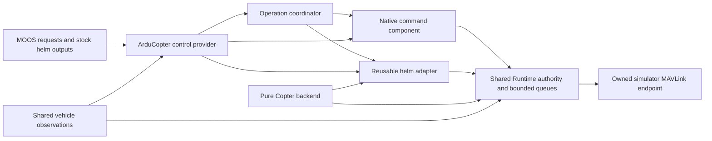

# ArduCopter vehicle control

`arducopter_control` is the control plugin for ArduCopter. It groups native flight-controller actions and stock-helm guidance. The module ID is `arducopter_control`; its descriptor profile is `arducopter`. The default identity gate binds the ArduPilot quadrotor. Explicit hexa and octa selections bind their own ArduPilot heartbeat identities and expose the dedicated lifecycle and helm configuration. Effectful use is restricted to the owned localhost native simulator. Receive-only and shadow modes send no MAVLink.

## Find functionality by operation

| Operation | Existing interface | Who decides motion? |
| --- | --- | --- |
| Enter Guided | `MAVMOOS_COMMAND=id=unique,action=guided` | Requests the native FC mode; this does not acquire helm permission |
| Arm/disarm | `action=arm` / `action=disarm` on the same request variable | Native FC action, subject to command/profile guards |
| Take off | `action=takeoff,height=5` | Native FC takeoff, height above home in metres |
| Navigate using the helm | `MAVMOOS_NAV_CONTROL=acquire` / `release` | Stock pHelmIvP produces course, speed and home-relative height; the bridge translates to Guided targets |
| Hold in native Loiter | `action=hold` | Native Copter Loiter, including its pilot-input policy; stops helm navigation |
| Helm loiter/stationkeeping | Configure ordinary helm behavior such as the demonstrated `BHV_StationKeep`, then acquire navigation | The configured helm behavior continues making navigation decisions in Guided |
| Guided recovery capture | Internal conditional response to loss/normal handoff | Bridge captures a current-position target only with eligible fresh Guided evidence; no public request is exposed |
| Return | Legacy `action=rtl`, or versioned `action=return,strategy=native|helm` | Native RTL lands under FC policy; the configured helm route to home stays airborne Guided |
| Land | `action=land` | Native FC landing; completion requires observed landed state |
| Execute a verified stored mission | Opt-in `MAVMOOS_MISSION_CONTROL=schema=1,id=unique,action=start,...` | FC AUTO follows the verified takeoff, waypoint or landing sequence; explicit execution ownership blocks competing helm/native navigation |

Legacy commands retain the complete `id=...,action=...` grammar and their existing meanings. The additional `MAVMOOS_CONTROL_REQUEST` interface supplies explicit `schema=1,id=...,action=...,strategy=native|guided|helm` operations inside this same provider. Goto supports Guided position or a configured helm route; hold supports native Loiter, explicit Guided capture or configured helm StationKeep; return supports native RTL or a configured helm route to home. Unsupported combinations reject. See the complete operation grammar, bounds and outcomes and [ordinary operation mission](../../missions/copter_operations/README.md). The current batch ledger records actual native acceptance separately from implemented support.

Optional [AUTO mission execution](copter_auto.md) belongs to this same control provider. The `missions` provider supplies transfer and verified stored content. `control_mission_execution=true` adds explicit start, pause, resume, abort and release. A waypoint plan starts from armed airborne Guided. A plan with a verified first TAKEOFF item starts from armed stopped Guided at HOME. Both retain ownership through completion and require explicit handback.

## Control ownership and freshness

Admitting an explicit native command revokes helm navigation and invalidates any normal-handoff resume permit. Acquiring or resuming navigation is blocked until that transaction ends or reaches its original deadline. Command completion does not restore helm control. After a native hold, land or return request, a later helm stream cannot silently recapture the vehicle.

The helm component consumes `DESIRED_HEADING`, `DESIRED_SPEED`, `DESIRED_ALTITUDE`, `IVPHELM_STATE` and `IVPHELM_ALLSTOP`. Heading here means travel course; altitude is height above the bound home reference. Startup `facing_policy=course|keep|heading` selects travel-course facing (default), omitted yaw, or explicit `facing_heading`; course omits yaw near zero speed, leaving FC policy to apply. It converts course/speed to horizontal velocity and applies bounded vertical correction. The FC retains its velocity, attitude and motor loops. Guided-position operations can override facing per request; helm facing remains a startup policy.

Input admission checks producer, original MOOS publication age, finite values, bounds, state/all-stop and post-boundary renewal. The cache is explicitly `ARRIVAL_GROUPED`: separate scalar messages do not prove one atomic helm decision. Stock pHelmIvP and its output contract are unchanged. Normal bounded handoffs can resume after fresh eligibility returns; takeover, restart, loss of prerequisites or an expired recovery window require explicit reacquisition. See the detailed helm contract and timing and operator diagnostics.

Native command completion distinguishes local queue admission, local send acceptance, `ACK_OBSERVED` and observed result. An ACK identifies the wire command number and can belong to an older request. Observable operations use fresh post-handoff state until their original operation deadline. The existing `command_ack_timeout` setting bounds handoff and the diagnostic ACK window. The host retains final permission, current-state, expiry and queue checks for every proposal. See command outcomes.

## pArduBridge operator equivalents

The parity ledger maps the original operator workflows to the current API. Startup opt-ins let a mission select the added paths independently.

```text
control_copter_adjustments = true
command_speed_min = 0.25
control_precision_loiter = true
dead_man_source = pDeadManPost
operation_helm_enabled = true
operation_helm_tasks = survey,voronoi
operation_helm_adjustments = true
```

| Operator workflow | Request and outcome |
| --- | --- |
| Change or reset Guided groundspeed | `MAVMOOS_COMMAND=id=speed1,action=change_speed,delta=0.3` or `action=reset_speed_min`. Requires idle, airborne Guided. Each relative request starts from fresh measured horizontal speed floored at the configured positive minimum, then applies the delta within the existing bounds. The minimum is configurable from 0.1 to 5 m/s. `UNCONFIRMED` reports a local send with no independent cap readback. |
| Change course as yaw | `MAVMOOS_COMMAND=id=yaw1,action=change_course,delta=20`. Requires idle, airborne Guided and a fresh heading. Sends the normalized target at 30°/s. `COMPLETED` uses a fresh measured heading within 5° of the target. |
| Change height under Guided | `MAVMOOS_CONTROL_REQUEST=schema=1,id=climb1,action=adjust_altitude,strategy=guided,delta=2`. Release the helm first. Captures fresh current XY, adds the offset to measured home-relative height, and checks the bounded goal region. |
| Change active helm demands | `MAVMOOS_CONTROL_REQUEST=schema=1,id=tune1,action=adjust_speed,strategy=helm,delta=0.2`. Also supports `adjust_altitude` with `delta` and `reset_speed_min` without a delta. Bind the ordinary waypoint/planner behavior's `updates` to `MAVMOOS_HELM_SPEED_UPDATE` and the ordinary altitude behavior's `updates` to `MAVMOOS_OPERATION_ALTITUDE_UPDATE`. Requires fresh demand from the configured active helm. `ACCEPTED` reports publication of the update. The stock behavior and solver own resulting motion. |
| Select survey or Voronoi | `MAVMOOS_CONTROL_REQUEST=schema=1,id=survey1,action=survey,strategy=helm,timeout=30` or `action=voronoi`. The corresponding stock mission behaviors use the exact `MAVMOOS_HELM_OPERATION=survey` or `voronoi` condition. Give helm consent separately. Selector changes retire previous inputs, and normal completion belongs to the mission planner. Use cancellation or the original timeout to end the task. |
| Select Precision Loiter | Use native `hold` first and wait for observed Loiter. Then post `MAVMOOS_COMMAND=id=prec1,action=precision_loiter_on` or `action=precision_loiter_off`. Enable uses post-handoff named reads of `PLND_ENABLED=1` and `PLND_TYPE=1..4`. The fixed auxiliary command 39 high/low requires fresh idle airborne Loiter. `UNCONFIRMED` reports a local send with no independent AUX state readback. The pinned quad fixture independently observed acquisition, 6.11 m of capture travel and stationary hold at the beacon, then held away after disable. Precision Loiter native evidence · [Landing-target observer](landing_target.md) |
| Respond to a dead-man event | The configured source may post `DEAD_MAN_POST_INTERRUPT=true`. A fresh event with idle command ownership can request native RTL from airborne Guided or Loiter. An active LAND is preserved. Pilot mode and the host AUTO/recovery fence inhibit the request. Use the producer's ordinary GCS heartbeat and reset settings. |
| Show home | `MAVMOOS_CONTROL_REQUEST=schema=1,id=home1,action=visualize_home` publishes `VIEW_MARKER` when the bound home and mission origin are available. |

Routine Copter LAND is limited to its observed autonomy modes and stays subject to the host's managed AUTO fence. Native commands track successful local handoff, matching ACK and observed results separately. A MOOS manual override yields navigation. Native return uses an explicit request or a configured dead-man source.

## Composition and discovery

Canonical full composition is:

```text
plugins = telemetry,parameters,arducopter_control
control_native_actions = true
control_helm = true
```

These are startup selection fields, not a complete simulation-control configuration. Matching host/module development ABI 10 builds are required. Default receive-only composition is telemetry only. Ordinary implicit shadow composition (`simulation_only=false`, `shadow_mode=true`, `helm_enabled=true`) adds control with its helm facet enabled and native actions disabled. Implicit `simulation_only=true` composition adds parameters and native actions, with helm following `helm_enabled`; setting shadow as well still prohibits all output but does not change that composition.

With explicit `plugins=arducopter_control`, both facets default on unless `helm_enabled` was explicitly set false or a facet override is supplied. Facets determine subscriptions and advertised interfaces; they never override receive-only/shadow effect prohibition. All four request channels remain reserved even when a facet is disabled, preventing a competing declared owner. Native/Guided operations require the native facet. AUTO additionally requires its separate default-false opt-in and verified stored mission. The operation helm strategy additionally requires `operation_helm_enabled=true` and the documented ordinary behavior bindings; normal legacy helm navigation requires no such opt-in.

| Legacy selection | Actual provider | Enabled facets before explicit overrides |
| --- | --- | --- |
| `commands` | `arducopter_control` | Native actions only |
| `helm` | `arducopter_control` | Helm only |
| `commands,helm` | One `arducopter_control` instance | Both |

Do not mix the canonical name with either legacy alias. The host rejects that ambiguous configuration. The old standard command/helm shared libraries are no longer built; aliases normalize before loading. Other providers, including parameter-only operation, remain independent. Legacy streamed parameter lists require the separate disarmed telemetry/parameter-only bench; loading a control backend excludes that bench even with both facets disabled.

`MAVMOOS_CAPABILITIES` is JSON schema 1 containing execution mode and `composition`: plugin ABI, actual module names, profiles, capabilities, request mappings and exclusive claims. Example capability IDs include `control.hold.native_loiter`, `control.return.native_rtl`, `control.navigation.helm` and internal `control.hold.guided_recovery`. Disabled facets are absent from capabilities. The catalog is republished after a MOOS reconnect; it describes support/configuration, not readiness, authority or vehicle qualification.

Inspect `MAVMOOS_RUNTIME_STATUS`, `MAVMOOS_HELM_STATUS`, `MAVMOOS_COMMAND_RESULT` and `MAVMOOS_TX_RESULT` for current state and outcomes. As with other retained MOOS values, check publication time and current app status: a cached catalog alone does not prove its publisher is still running. Runtime status includes `control_profile` and `configuration_valid`; a configuration failure invalidates the runtime until process restart. No third-party ABI stability, live replacement or plugin security isolation is promised.

## Standard hexa and octa

Set `vehicle_profile=arducopter` and `copter_frame=hexa` or `copter_frame=octa` to select the corresponding ArduPilot heartbeat type. The default is `copter_frame=quad`. All three select the same control provider and operation policies. The owned hexa and octa simulation setup selects telemetry and the control provider. Include `parameters` for parameter workflows and `missions` for verified stored-plan transfer. Enable the desired control facets and their individual opt-ins.

The versioned control-request interface, native adjustments, Precision Loiter, dead-man Return, stock helm and managed AUTO use the same freshness and ownership gates as quad. For managed AUTO, enable the native facet and follow the verified upload and private recovery directory setup. The frame evidence covers the standard plus layouts on pinned ArduCopter 4.6.3 and records the actual loaded capabilities, heartbeat identity, frame parameters and effects. Separate providers retain their own qualification scopes. [AUTO setup](copter_auto.md) · Advanced frame qualification · Earlier basic lifecycle

## Internal responsibilities



The provider owns its backend, native and helm components, and the operation coordinator. The coordinator delegates native actions to the existing command component and helm guidance to the existing adapter; it does not open another transport or bypass shared permission. The backend supplies mode/identity predicates, acquisition command proposals, input envelopes and target encoding. Its interface has no `Services` or transport access. The host samples time, arbitrates authority, preserves original deadlines and performs the final send. Trusted C++ plugins are not sandboxed; this interface boundary is an engineering contract.

Telemetry and parameters have their own stream requirements and firmware traits, so neither needs to load vehicle control. Mission data transfer is implemented as an independent `missions` provider; optional AUTO execution collaborates with that provider through host-held verified content and uses this sole control owner/shared sender. Fence/rally, payloads, sensing and bulk services retain separate boundaries. See the [architecture guide](../architecture.md#plugin-responsibilities) for the shared plugin boundaries.

## Capability and compatibility evidence

The [machine-readable registry](../../config/capabilities/copter.json) groups meaningful native/Guided/helm variants with their interface, owner, prerequisites, original lifetime/cancellation and test identities. Deferred/unsupported operations stay explicit. Historical source cells do not qualify a new host or firmware build. The CI/firmware/Copter ledger records broader route/hold/return and repeated fixed-wind scenarios and additive exact-profile evidence. Shared firmware observations are diagnostic context; this provider never grants authority based on a version or capability mask.
