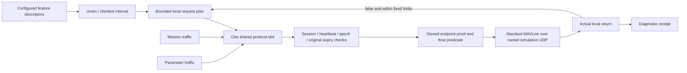

# Observation stream setup

This is a shared host service, not a separately loaded feature plugin. Observation providers declare desired message IDs and intervals in `PluginDescriptor::observation_streams`; the host merges duplicates to the shortest interval and owns all sending. MAVMOOS still encodes standard MAVLink `COMMAND_LONG` / `MAV_CMD_SET_MESSAGE_INTERVAL`511. There is no new UDP or MAVLink format, FC extension or helm change.

NAV, recovery hold and explicit native-command work run before this single bulk slot. Three ready lanes—mission, parameter, stream setup—share round-robin arbitration, at most one lane per tick. A stream waiting for its pacing time does not reserve the slot. This preserves control priority and avoids adding an independent burst of housekeeping traffic. It provides bounded local work; it is not a real-time scheduling or remote delivery guarantee.

Bounds apply to each admitted plan. An explicit valid reset may admit a new plan; these are not lifetime traffic caps across arbitrary repeated reconfiguration. Scheduling pressure may exhaust the original deadline before every demand uses all its attempts.

## Fixed internal profile

| Bound | Value |
|---|---|
| Canonical message demands |32 |
| Raw helper input demands |1024; invalid/oversized plans fail closed |
| Original batch lifetime |10 seconds from admission |
| Attempts per demand |At most3 local send attempts |
| Global request spacing |At least0.1s from the previous attempt/completion |
| Retry after a locally rejected attempt |At least0.2s; original expiry retained |

Admission requires an observed fresh heartbeat in explicitly enabled owned simulation control mode. Each reset/configuration/module change starts a new epoch and retires old work; any frame already encoded retains its old epoch and deadline through final endpoint proof. Finite nondecreasing host time is required. An unqualified clock sample cancels work and leaves stream status `CLOCK_FAULT` until a valid session/configuration reset. Receive-only and shadow modes do not admit a send plan and transmit zero MAVLink.

False local returns may retry within those limits. An OS-accepted datagram is terminal for that local demand and is never replayed by this service. A delayed return after the deadline remains explicitly accepted with a **late receipt** marker; that marker does not claim the actual syscall happened after expiry. Acceptance followed by reset remains visible in the result event but cannot mutate the new plan. Cancellation cannot recall already accepted or transmitted bytes.

Remote `COMMAND_ACK`511 does not identify the requested message ID/interval. This service neither correlates it to a demand nor uses it as proof that the FC applied the rate. Requested cadence, local send result, observed incoming cadence and control readiness are separate facts. The service takes no navigation grant or command lease and makes no vehicle-health verdict.

## MOOS diagnostics

`MAVMOOS_STREAM_STATUS` is schema-1 JSON with epoch, state/reason, original admission/expiry, queue and terminal counts, attempts, reset-retired count and per-demand state. `LOCAL_ACCEPTED` means a successful local handoff return. `EXHAUSTED` means all 3 attempts returned false; `EXPIRED` means the original bound elapsed. A reset clears item records while retaining its reason and `last_reset_retired` count. `CLOCK_FAULT` is latched until a valid reset. Repeated publication does not renew any timestamp or deadline.

`MAVMOOS_STREAM_REQUEST_RESULT` reports the copied epoch/message/interval/attempt/original expiry, actual `LOCAL_ACCEPTED` or `NOT_ACCEPTED`, whether the receipt still matches current work, resulting state and post-return timing qualification. Unqualified timing produces null `post_return_at` and `late`, with `clock_valid:false`. Both records retain `remote_application:"unconfirmed"` and `ack_correlation:"not_inferred"`.

The implementation is [`ObservationRequests`](../../src/libmavmoos_runtime/ObservationRequests.h), [`RuntimeStream`](../../src/libmavmoos_runtime/RuntimeStream.cpp) and the existing Runtime arbitration. Bounds are deliberately internal constants for this qualified candidate. No public configuration knobs, automatic indefinite repair loop, accepted-packet retry, FC rate negotiation or field-link guarantee are introduced.

MAVROS remains the precedent for shared transport/vehicle context and feature-declared observation needs; pArduBridge remains the vehicle/workflow reference. Their reuse and exact source evidence are archived in the batch ledger. The host-owned pacing/cancellation policy answers this checkout's reproduced one-shot local-send gap and its existing original-expiry contracts; it is not attributed to either reference as an unchanged implementation.
