# Initial ArduCopter Guided profile

October 29, 2026. Logical draft ID: `arducopter-guided-01`. **Proposed architecture; not execution-qualified.** Firmware release, airframe, backend and deployment parameter set remain unselected. No bridge/source code, dependencies, firmware parameters or runnable missions were changed, and no simulator/vehicle experiment was run. Stock MOOS-IvP/pHelmIvP remains unmodified under [accepted decision 0004](../../decisions/0004-use-stock-moos-ivp.md).

## 1. Intended first use

One configured ArduCopter, one selected stock helm source and one MAVMOOS host on a direct trusted MOOS path. The vehicle is already armed and FC-reported airborne before navigation acquisition. The helm provides horizontal course/groundspeed and an altitude request relative to the current home reference. The bridge translates them into Guided velocity targets.

This profile does not arm, take off, land, disarm, start an AUTO mission, command raw thrust, support Guided_NoGPS, arbitrate multiple helms or automatically recover after pilot takeover. Such operations may exist elsewhere in the broader bridge under separate contracts; helm activity does not authorize them.

Proposed acquisition begins only from observed native **LOITER or GUIDED**. Other modes, including AUTO, RTL, LAND and pilot-controlled modes, are rejected for entry in this first profile. This is deliberately narrower than pArduBridge's general mode-change allowlist. During active navigation, observed FC mode must remain ordinary GUIDED; the sender never re-enters it on a timer.

The target/system/component and ArduCopter identity evidence must be configured and checked. A library's `Offboard` enum is acceptable only when its adapter has established that it represents this ArduCopter's native GUIDED mode; it is not permission to treat PX4 Offboard or Guided_NoGPS as equivalent.

## 2. What is retained and what changes

| Area | pArduBridge reference | This draft's proposal |
| --- | --- | --- |
| Helm quantities | Course via DESIRED_HEADING, speed and altitude scalars | Retain the three stock inputs with explicit units/reference and per-field metadata |
| Horizontal control | Course/speed to north/east velocity | Retain mapping; reject negative/out-of-envelope speed rather than silently clamping it to zero |
| Vertical control | Relative-altitude feedback, gain 0.5/s, down-speed limit ±1 m/s | Retain those numbers as draft tuning candidates, explicitly home-relative rather than terrain AGL |
| Facing | Yaw follows course above 0.05 m/s; ignored near zero | Retain this explicit policy for this profile only |
| Airborne guard | Stream uses relative altitude at/above a five-metre threshold | Require fresh FC `IN_AIR` state; do not infer airborne state from altitude |
| Guided handoff | Separate request, five-second timeout and 0.5-second boolean dwell | Retain mode-first separation and candidate timing, but require new target heartbeat reports during confirmation |
| Intent age | Oldest local field receipt, default two seconds | Retain two-second candidate bound plus source-publication checks, field spread and post-acquisition readiness |
| Loss | Suppress stale velocity; later schedule current-position Guided hold | Revoke first, latch recovery, and permit at most one bounded position-hold handoff only with fresh state/pose and FC still Guided |

The [pinned source/evidence](evidence.md) distinguishes observed behavior from these proposed choices. No existing implementation is treated as validated against this profile.

## 3. Helm inputs and control law

| Stock input | Proposed meaning | Admission rule |
| --- | --- | --- |
| `DESIRED_HEADING` | Desired horizontal course over ground, degrees clockwise from North | Finite; normalize modulo 360; not a standalone body-yaw request |
| `DESIRED_SPEED` | Horizontal groundspeed magnitude, m/s | Finite and nonnegative; within the configured vehicle/mission envelope |
| `DESIRED_ALTITUDE` | Target metres above the bound FC home altitude reference | Finite; within configured relative-height bounds; reference known and unchanged |

All three are required, with original MOOS source/community/message-time plus monotonic receipt metadata. Zero is a value, not a missing-data sentinel. Required maximum horizontal speed and relative-height bounds must be supplied by the eventual vehicle/mission configuration; the draft invents no universal envelope. A rejected dimension invalidates the candidate as a whole.

For course `c` in radians, speed `s`, target home-relative altitude `h*` and current home-relative altitude `h`:

```text
v_north = s * cos(c)
v_east  = s * sin(c)
v_down  = clamp(-0.5 * (h* - h), -1.0, +1.0)  metres/second
```

The bridge owns this outer altitude-to-vertical-velocity law. ArduCopter owns its velocity/attitude/motor controllers. Its own limits may further affect motion; the bridge reports requested quantities and its applied target without claiming FC tracking.

The proposed wire target is `SET_POSITION_TARGET_LOCAL_NED` in `MAV_FRAME_LOCAL_NED`. Use velocity XYZ plus course yaw when `s > 0.05` m/s, mask 2503; at/below the threshold ignore yaw, mask 3527. Position, acceleration and yaw-rate fields are ignored. Backend timestamp convention must be specified for the selected protocol/library; transmission time is not a new helm publication or decision time.

Zero speed commands zero horizontal velocity but can still command a climb/descent toward the altitude target. Ignoring yaw means this profile sends no new yaw request; FC/pilot yaw behavior still depends on configured options. All-stop is handled separately and never converted into a zero-altitude/zero-speed action.

The home reference is bound at acquisition. Known home/reference changes or uncertain continuity invalidate the profile's altitude eligibility. The SDK's `relative_altitude_m` is not terrain clearance. Native XY stabilization must remain enabled; review `GUID_OPTIONS`, yaw behavior, speed/acceleration limits, fences and failsafe settings for the actual release. The bridge does not change those parameters automatically.

## 4. Control acquisition

```mermaid
stateDiagram-v2
  [*] --> INHIBITED
  INHIBITED --> READY: target/profile/current observations established
  READY --> ACQUIRING: explicit authorized acquisition request
  ACQUIRING --> ACTIVE: new Guided reports + current post-boundary inputs
  ACQUIRING --> RECOVERY_REQUIRED: rejection, timeout, override or ambiguity
  ACTIVE --> RELEASING: input/state loss or explicit release
  RELEASING --> INHIBITED: no uncertain residual; explicit reacquisition required
  RELEASING --> RECOVERY_REQUIRED: handoff/outcome/continuity uncertain
  RECOVERY_REQUIRED --> READY: explicit reconciliation with current evidence
```



1. Admit an explicit navigation-acquisition request. Bind current target, selected helm source, profile/envelope/home reference and a new local control generation. Clear old field readiness and start the five-second candidate deadline at **admission**, including queue/mode/observation wait.
2. Require armed, fresh `IN_AIR`, usable position/velocity and required estimator/home readiness, eligible stock DRIVE evidence and known clear all-stop. Do not require an “armable” pre-arm flag for an already airborne vehicle. Collect new qualifying publications for all three helm inputs after the acquisition boundary; retained registration data cannot satisfy it.
3. If starting from LOITER, request GUIDED once through the operation coordinator. If already GUIDED, record the mode-change no-op and still perform fresh confirmation. No arming/takeoff or routine helm velocity is authorized by this request alone.
4. Require at least two distinct target heartbeat reports observed after the request, all indicating GUIDED/armed, spanning at least 0.5 seconds, with no contradictory intervening evidence or over-age gap. A cached SDK mode boolean plus a timer is insufficient. This is sample-backed confirmation, not proof of unobserved continuous state or causal attribution to our request.
5. Re-evaluate all input/observation/permission/backend guards and begin the 10 Hz candidate navigation schedule only when eligible. `ACTIVE` means bridge permission, not motion or target-tracking confirmation.

This draft follows pArduBridge's **mode-first** acquisition shape. It selects no pre-entry velocity stream or invented zero target. Behavior between GUIDED entry and the first target is an explicit firmware qualification item. If the selected release needs another preparation sequence, revise this profile before enabling it; do not borrow PX4 entry rules or hide a stream in the mode request.

Mode submission/SDK success is reported separately from observed GUIDED confirmation. On rejection, contradiction or deadline expiry, stop further acquisition work and invalidate its generation. A possibly delayed mode command can leave remote outcome uncertain; SDK retries/residual work must be bounded or reconciled before another conflicting acquisition.

## 5. Freshness, cadence and candidate limits

**All numbers below are draft review/tuning candidates, not operational recommendations or achieved bounds.** “Reference” identifies numbers observed in the pinned code; other values are proposed to make the profile concrete and require later review.

| Quantity / timer | Draft value or rule | Basis |
| --- | --- | --- |
| Required helm field publication age | At most 2.0 s, using conservative clock uncertainty | Extends reference's two-second receipt watchdog to stock message metadata |
| Required helm field silence age | At most 2.0 s from qualifying monotonic receipt | Reference default |
| Spread of required field publication times | At most 0.5 s | New approximate grouping bound; does not prove one cycle |
| Selected DRIVE heartbeat age | At most 2.0 s | New proposed producer-liveness bound; independent of scalar age |
| MOOS source-clock uncertainty budget | At most 0.10 s, demonstrated for intended direct deployment; reject unqualified timing or timestamps outside the declared skew/future tolerance | New assumption to qualify; not a clock-sync feature already implemented |
| FC mode/armed evidence | Latest target heartbeat receipt age at most 2.0 s | New bound; raw received reports, not last SDK value-change callback |
| FC position/relative altitude and velocity | Each trusted acquisition age at most 0.5 s | New bound; reference requests 5 Hz position/velocity, giving 0.2 s nominal periods |
| Required estimator/home-readiness evidence | At most 3.0 s for its underlying dynamic reports | Reference health-age constant; use navigation prerequisites, not aggregate pre-arm eligibility |
| Reported landed state | At most 2.0 s and `IN_AIR` | Reference landed-state age constant, applied here to navigation |
| Guided acquisition deadline | 5.0 s from request admission | Reference timeout value; start boundary deliberately tightened |
| Guided confirmation | At least two new reports spanning 0.5 s; evidence/gaps within FC age bound | Reference dwell value with stronger sample requirement |
| Target send period | 0.10 s / 10 Hz | Reference sender's nominal empty-queue sleep; no guarantee copied from it |
| Maximum visible local handoff gap | 0.30 s | New three-period candidate budget; a miss triggers loss handling |
| Maximum selected-work age before last controllable handoff | 0.10 s, also bounded by every input/observation/permission expiry | New queue budget; replace old unsent navigation instead of accumulating it |
| Conditional loss-hold dispatch window | At most 0.5 s from trigger, and no later than all required evidence deadlines | New bounded response permission; one handoff attempt |

Every send recomputes eligibility at the current monotonic time. Use the earliest deadline; exact duplicate notifications and repeated transmissions do not extend stored field validity. An acquisition-age bound on FC data is not a proof of physical measurement age. If FC sample time is unavailable/unmapped, record that limitation and qualify transport/cache behavior before claiming control-grade freshness. Home is a bound reference with explicit change handling, not a value made “fresh” by re-reading the cache.

Freshness must come from the underlying received evidence. A backend that exposes only value-change callbacks cannot repeatedly refresh a mode/health/landed-state age by polling the same value. It must provide the needed receive provenance or leave the capability unavailable. Requested telemetry rates must be verified from observed traffic; a successful rate request alone is insufficient.

There is no promise of a common helm generation: coherence remains `ARRIVAL_GROUPED`, with publication-age and field-spread limits. A fresh new scalar publication can renew that field even when its number is unchanged. A live heartbeat, local tick or resend cannot renew the three-field set collectively.

Consume the selected stock helm's existing state and all-stop channels using the [stock compatibility rules](../../design/2026-10-29-built-in-modules/stock-helm.md). `IVPHELM_STATE=DRIVE` is liveness/state evidence, not a completed-decision marker. `IVPHELM_ALLSTOP=clear` is a latched state, not a periodic heartbeat: its old timestamp alone is not a loss trigger. Unknown/non-clear all-stop blocks eligibility, and a later clear cannot renew scalar deadlines or undo a loss latch. No new helm publication or producer hook is required.

The local handoff-gap limit is not an FC receipt guarantee. Read and record actual `GUID_TIMEOUT` and link/SDK delay behavior; the profile must fit the chosen FC setting without hidden queues/retries defeating it. The official guidance distinguishes Guided-command timeout from GCS heartbeat failsafe. A healthy bridge can keep heartbeating after the helm stalls, so GCS failsafe is not a helm watchdog. [Evidence and parameter context](evidence.md).

For an **illustrative** configured FC timeout of 3 s, a sender that continues until the two-second helm limit can move the FC timeout horizon to roughly **five seconds after the last helm publication**, before considering remaining delay or braking. Neither timeout value establishes a two-second physical stop. This arithmetic is a reason to qualify the budgets together, not a promised stopping distance/time.

## 6. Loss, review and next qualification

[Loss and recovery](loss-and-review.md) specifies the ordered response: revoke routine navigation, latch the condition, optionally attempt a fresh current-position hold while still Guided, and require explicit reacquisition. It also lists paper scenarios and unresolved release/configuration/backend choices.

[Evidence](evidence.md) and the 13-file source manifest pin the reference code and official wiki sources. Candidate values/behavior in this document remain proposals. No firmware release, numerical envelope, physical response, timing bound or interface has been accepted or demonstrated by drafting it.
