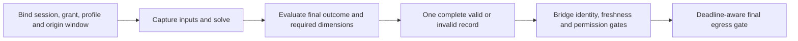

# Coherent helm output: Q-NAV-03

October 28, 2026. Static source findings plus proposed interface choices. Based on MOOS-IvP `023fb54e00692611ecee2cd6f1138d10eec2127e`, separately identified Core MOOS, and the archived MIT manuals. See [evidence](evidence.md). No helm code was changed or run.

## 1. What must be coherent

The bridge needs evidence that the controlled quantities, presence/absence of dimensions, decision validity, producer incarnation, and applicable authority binding describe one eligible decision. Thread-safe reads of individual scalars only prevent particular memory races. They do not establish this relationship.

Three independent properties matter:

- **Vector coherence:** values and missing dimensions describe one solver result.
- **Outcome coherence:** the result passed the producer's final policy checks, or is explicitly invalid for a named reason.
- **Admission coherence:** that outcome carries the source/session/authority/origin-age evidence under which the bridge may use it.

The current summary can help recover the first property under strict conditions. It does not directly supply the full second or third. This distinction explains both the conditional value of companion adapters and the producer-side recommendation.

## 2. The actual publication order

The [MIT helm chapter](https://oceanai.mit.edu/ivpman/pdfs/chap_helm_as_moos.pdf), extracted lines 459–479, documents a journal-style summary and a state heartbeat. It does not specify a transactional control envelope. The inspected source supplies the exact order below. [E1](evidence.md#e1-helm-cycle-and-output-order), [M1](evidence.md#m1-mit-manuals).

| Order within `HelmIvP::Iterate()` | What happens | Consequence for a consumer |
| --- | --- | --- |
| 1 | Update/post `IVPHELM_STATE` at 348–349 | A heartbeat can precede a stalled or skipped solver call |
| 2 | Return early if disabled/standby, holding for navigation, manual override, or startup delay | A process iteration need not produce a new decision |
| 3 | Call `determineNextDecision()` at 422 | Engine increments its counter, clears the report, produces behavior functions and solves |
| 4 | `postBehaviorMessages()` at 452 posts `IVPHELM_ITER` at 602 | The counter is after solver return but **before** final output checks and decision scalar publication |
| 5 | Post `IVPHELM_SUMMARY` at 469 | Report describes the solver result before the final helm policy/completeness checks |
| 6 | At 501–532 evaluate halted/empty/no-goal and required decision dimensions | These checks determine whether to post decisions or invoke all-stop |
| 7 | At 534–549 post all-stop or normal `DESIRED_*` values | Multiple ordinary `Notify` calls; normal course aliases to heading and uses the configured prefix |

This is a producer execution order, not a promise that a consumer callback receives the whole iteration in one batch. Core MOOS stamps ordinary notifications individually, retains values for registration, applies subscriber notification periods, and can sort fetched mail by message time. Queues are finite. None of these operations introduces a shared helm transaction identifier. [E5](evidence.md#e5-core-moos-messages-mail-and-retention).

`IVPHELM_ITER` is therefore useful solver-progress evidence, but interpreting it as “all required decision scalars for this iteration have arrived and passed checks” reverses the source order. Waiting for a later counter to bracket the preceding fields adds a full-cycle delay and still requires a proven uninterrupted, ordered, loss-detectable, single-producer stream, plus handling of all-stop and early-return paths. Those requirements are not provided by a bare subscription.

## 3. What the summary does and does not contain

`HelmReport::getReportAsString()` always includes iteration and a two-decimal `utc_time`, but omits many fields when unchanged. The decision summary is emitted as a group when its formatted text changes. That group enumerates the domain, including `varbalk` for missing decisions. A full summary can be requested with `IVPHELM_REJOURNAL`; the next applicable solver iteration consumes the Boolean request and returns to deltas afterward. [E2](evidence.md#e2-summary-encoding-and-parsing), [E3](evidence.md#e3-restart-and-rejournal).

The [uHelmScope manual](https://oceanai.mit.edu/ivpman/pdfs/app_uhelmscope.pdf), extracted lines 118–125 and 299–324, documents missing optional decisions and the full-then-journal pattern. That is a useful diagnostic reconstruction protocol. It has several qualifications for a proposed control adapter:

1. **A baseline is required.** A late subscriber may receive a retained delta without the previous state it refers to. Omitted values are not zero and are not an invitation to use arbitrary cached scalars.
2. **Loss of a change invalidates reconstruction.** For example, cycle 40 changes course to 90, its summary is lost, and cycle 41 omits the unchanged decision group. Applying 41 to the state from 39 produces a wrong but apparently current vector. Strict continuity checks must discard the reconstruction after a gap, reconnect, source/session change, or unexplained regression. A fresh full baseline is then required.
3. **Numbers are a formatted representation.** Decision values use `doubleToStringX` with a default five decimal places. Changes below that representation can disappear from the journal comparison. An adapter must either accept a documented quantization contract or avoid presenting these values as exact scalar-output doubles. [E4](evidence.md#e4-summary-numeric-representation).
4. **Missingness requires a strict parser.** The inspected `string2HelmReport` path calls `atof` on the value token. Thus a token such as `varbalk` becomes numeric zero in that path, even though the serializer and manual distinguish missing decisions. A control parser must preserve missingness and reject malformed/non-finite/unknown values. Reusing the display parser would lose required information.
5. **Not all policy is in the report.** The serializer includes `active_goal`, while the inspected parser does not restore it. Final all-stop selection also depends on helm configuration such as mandatory goals and optional dimensions. Native all-stop can defer scalar zeroing for an initial incomplete/empty/no-goal cycle. A report parser alone cannot reproduce final output eligibility without explicitly reproducing and binding that policy.
6. **Rejournal is not a correlated challenge.** It carries no receiver-owned nonce in the returned summary. Other readers can request it. A delayed full report or a pre-existing request is not proof that a specific new bridge window caused this decision.

A qualified companion could interpret the summary as a **solver-report source** if it establishes a baseline, detects gaps, handles missingness/precision, pins configuration, and performs its own explicitly specified policy. That would be an adapter making eligibility decisions under its own contract. It would not automatically be a faithful certificate of the native helm's final publication path. It still needs a separate original-age mechanism.

## 4. Why arrival and timestamps are insufficient

Suppose cycle N publishes heading and speed, then cycle N+1 publishes a counter and heading before the receiver processes mail. A cache read can combine N+1 heading with N speed. Small time differences or a common callback do not prove a shared generation. Equal numbers make this harder to notice, not easier to certify.

The scalar output calls do not attach the solver iteration as source-auxiliary metadata. Their MOOS times describe notification construction. The report's `utc_time` is derived from the time passed into the engine at cycle entry; it is not a separately measured completion time. A long solver call can therefore produce recently stamped scalars for an old-started decision. A useful strict age bound must include the computation interval. [E1](evidence.md#e1-helm-cycle-and-output-order), [E5](evidence.md#e5-core-moos-messages-mail-and-retention), [E6](evidence.md#e6-cycle-time-provenance).

Source-name filtering is necessary for distinguishing configured helms, but does not create a generation ID or trust proof. Native standby behavior also permits a delayed primary to publish one more decision and then an all-stop. A bridge must not merge those fields with the new owner's output. [M1](evidence.md#m1-mit-manuals), [handoff analysis](boundary-and-recovery.md#3-standby-and-operator-arbitration-q-auth-05).

## 5. Interface alternatives

| Route | What it can provide | Remaining cost/limitation | Recommendation |
| --- | --- | --- | --- |
| Producer emits a complete outcome envelope | One self-contained vector/invalidity record after final checks, with cycle/session/origin bindings | Requires a producer integration point or maintained source variant; output paths and maintenance must be reviewed | Preferred strict path |
| Producer tags every scalar plus emits an explicit commit/manifest | Verifiable assembly if all required fields, membership, validity and bindings match | Also changes the producer; partial loss/reassembly, duplicate and retention handling are more complicated | Valid alternative if a full envelope has a demonstrated constraint |
| Companion interprets journal summaries | Conditional reconstruction of solver-report vectors | Requires baseline, strict parser, continuity, quantization, policy/configuration binding, and separate freshness; no native final-output certificate | Useful study/diagnostic route; possible separately qualified profile |
| Companion brackets untagged scalars with iteration/summary/time | Recent grouping or conditional reconstruction under additional delivery assumptions | Markers precede output; incomplete paths, loss, reconnect and source overlap remain | Do not label strict generation-verified on current evidence |
| Native receiver simply consumes `DESIRED_*` | Familiar legacy interface | No complete-generation or end-to-end age guarantee | Explicit legacy interoperability scope only |

A companion is not disfavored because it is a separate process. The missing information is at the decision producer. Moving the collector into `iMAVLink` would not create that information either.

## 6. Recommended producer contract

This is a semantic integration proposal, not a final channel name, encoding, plugin ABI, or authorization to patch upstream.

- Capture the producer/session, current bridge/vehicle/authority binding, profile/configuration revision, and freshness window **before** the decision's designated input-capture/solve start. Work already in progress cannot acquire a new window or authority epoch after completion.
- After the solver returns and final helm validity/completeness policy has been evaluated, form one immutable record. Include all supported domain values, explicit absent/uncontrolled dimensions, quantities/references, decision validity and reason, original cycle identity and origin-age evidence.
- A successful completed cycle emits a new sequence even when every numerical value is unchanged. A transport resend preserves the original sequence/body/deadline. A fresh heartbeat never creates a valid navigation sequence.
- Emit explicit invalidity outcomes for halted/incomplete/empty/no-goal decisions and state changes that remove eligibility. Cover manual override, PARK, standby/disabled, restart and other early-return paths. A repeated state/liveness record does not renew navigation. A process crash remains a missing-update case handled by expiry.
- Order decision and invalidation records within one producer-session stream. Keep the engine iteration as a diagnostic field; it is not sufficient identity across an engine restart or counter wrap. Restart of the decision engine requires a new producer incarnation/binding even if the OS process remains alive.
- Make the controlled profile's required dimensions explicit. A genuinely optional helm dimension can still be mandatory for a particular bridge profile; reject or explicitly leave it uncontrolled according to that profile. Never inherit it from an unrelated cycle.
- Bind final eligibility to the producer's known state at that boundary and recheck actual bridge authority at admission and egress. A queued takeover notice or external override may not yet have been observed by the producer; its envelope is not proof of global exclusivity.

Existing scalar publications can remain available for legacy consumers in a future implementation, with their documented limitations. A final envelope must carry its own validity, so the studied normal/all-stop prefix asymmetry does not determine strict control semantics. An invalid envelope is not a request to send all numeric fields as zeros.

The integration design must identify a producer-side hook that covers these paths without duplicating contradictory eligibility logic. A custom behavior posting a message is not automatically such a hook: it runs before the final multi-behavior decision is known.

## 7. Disposition

**Source question answered:** the inspected state/iteration/summary publications do not directly provide the proposed complete control envelope with final validity and session bindings. Summary reconstruction has conditional value and specific failure modes.

**Proposed choice:** producer-side complete outcome envelope, recorded in [decision 0003](../../decisions/0003-coherent-helm-and-origin-freshness.md).

**Q-NAV-03 remains open:** adoption, integration/maintenance approach, event/sequence schema, final policy coverage, source/session setup and later validation. No claim is made that every possible non-invasive adapter is impossible, or that a producer envelope alone proves fresh inputs, acceptable control laws, timely egress, or FC tracking.
