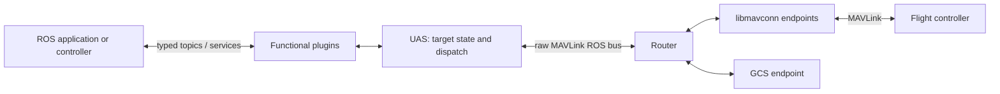
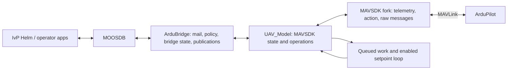
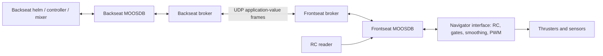

# Operating-model comparison

October 28, 2026. Read with evidence and version limits. This comparison describes the selected implementations and MOOS documentation, then derives implications for MAVMOOS. Recommendations remain proposals.

## 1. Compare responsibilities at the same level

MOOS is the communication/application framework; the IvP Helm is an autonomy decision engine running within it. MAVROS translates between MAVLink and ROS application interfaces. The reference MAVROS process is not itself a general mission planner or the equivalent of pHelmIvP. Likewise, a MOOS application need not use the helm. Treating every ROS topic as a MOOS scalar would overlook transactions, geometry, routing, and scheduling. MO01, MO02, MR02.

| Responsibility | MAVROS reference | MOOS-IvP / local references | MAVMOOS question |
| --- | --- | --- | --- |
| Inter-process communication | Concrete ROS messages, subscriptions, services; a raw MAVLink bus between Router/UAS | MOOSDB notification/registration/mail; primitive or application-defined binary/string payloads | What semantic contract must be added at the bridge boundary? |
| Mission/autonomy decision | External application/controller; illustrative Offboard publisher is separate | pHelmIvP reconciles behaviors over configured decision domains | How does a helm decision become one eligible vehicle intent? |
| Navigation/actuator control | Depends on selected setpoint type and FC mode | pMarinePIDV22 is one conventional controller; BlueBoat adds thrust mixing/direct Navigator output | Which loops remain on the FC and which external loops are actually needed? |
| Wire transport/routing | libmavconn, Router endpoints, UAS/plugin dispatch | pArduBridge uses MAVSDK; BlueBoat brokers carry application values | What routing scope and reusable protocol boundary are required? |
| Navigation authority | The traced setpoint plugin does not arbitrate ownership | Helm states, manual override, standby; project-specific pArduBridge authority | What requests, evidence, and external overrides govern transmission? |
| Telemetry interpretation | Typed pose/twist/odometry messages, frame IDs, synchronization helper | Conventional NAV values and source/time metadata; pArduBridge geographic conversion | How are coordinate origin, validity, sample time, and observation age exposed? |

## 2. Reference process/data flows

### MAVROS ROS 2 over MAVLink

The all-in-one executable composes Router and UAS, with intra-process communication enabled. Plugins have ROS nodes and are added to a UAS executor. Receive handlers are selected by MAVLink message ID and execute through UAS dispatch; this is different from a plugin's ROS subscription/service callbacks. The raw bus explicitly uses best-effort, volatile QoS with depth 1000; application topic/service choices differ. Composition does not imply one callback or one thread. MR02, MR03.

The Router learns addresses and forwards among endpoint types. It skips echo to the source and same-type endpoints, and falls back to broadcast when a targeted address finds no destination. This is useful routing behavior but not a command-ownership or authorization policy. Target IDs and plugin source filters remain distinct from permission to control the vehicle. The transport reconnect loop reopens closed endpoints; it does not establish an application's readiness to resume navigation. MR02, router lines 48–117, 361–383, 442–478.

### Existing pArduBridge

Source has a command-sender thread, thread-safe telemetry variables, MOOS-thread policies/publications, and asynchronous SDK callbacks. Not every command passes through the bridge's own queue: the ARM path is initiated from Iterate and submits `arm_async` directly. The sender loop also executes potentially blocking queued operations before the next setpoint call. Its 100 ms idle-stream sleep is a nominal cadence, not a bounded 10 Hz guarantee under load. PA01, PA02.

The integration supplies both an autopilot API and mission-specific helm coordination. `AUTOPILOT_MODE` labels bridge state, `HELM_STATUS` is a project-specific switch, and actual FC mode comes from SDK telemetry. Its human-readable `CONTROL_AUTHORITY` is derived from bridge state, not independent evidence of FC acceptance. These distinctions should become explicit in MAVMOOS interfaces. No generic PX4 support is demonstrated by the existence of PX4-aware code inside its SDK. PA01, app lines 162–206 and 2270–2349.

### BlueBoat direct hardware and two communities

The deck describes this separation and the local source provides corresponding brokers and a direct Navigator interface. It is a useful comparison for fault boundaries and actuator ownership. It is not proof that two communities isolate every failure, nor a MAVLink autopilot architecture to copy. Source authorship also varies across components. BB01.

## 3. Communication similarities and meaningful differences

Both reference systems support modular applications consuming observations and publishing intent. Both require attention to scheduling, queues, source identity, timing, diagnostics, and stale data. Neither middleware guarantees a meaningful physical command merely because its message was delivered.

MOOS is not restricted to doubles and strings: the MIT manual documents binary payloads and source, auxiliary, timestamp, and community metadata. It also explains that one mailbox fetch may contain multiple notifications for the same variable. Therefore, “MOOS only stores the latest value” is incomplete as a delivery model. The inspected DB both stores current state and places notifications in subscriber mailboxes. Registration can immediately deliver an old existing value. MO01.

The distinction matters for commands. A variable such as `ARM_UAV=true` is also retained DB state. A newly registering bridge can receive that value without a new operator action. A transaction interface therefore needs explicit expiry/identity/replay rules. The middleware does not know whether the value describes state, an event, a renewed lease, or a request. The DB enforces basic data-type consistency, not a units/frame/transaction schema. This is an inference from the source and must be addressed in the future interface design. MO01, [trace 2](trace-02-acknowledged-command.md).

Conversely, MAVROS uses concrete message/service types, but that does not make all its services equivalent. `CommandBool` includes `success` and `result`; `SetMode` includes `mode_sent`; setpoint callbacks do not return FC command acknowledgments. The inspected raw bus is not configured for reliable delivery. Study the actual endpoint contract instead of assigning a uniform ROS guarantee. MR05, MR06.

## 4. Helm intent is not an actuator command or a health lease

The IvP solver works over a configurable domain. The selected UAV mission configures course, speed, and altitude; another mission may use depth or additional dimensions. Successful helm decisions are published separately as `DESIRED_*`, with course aliased to heading. A configured helm prefix affects normal decision publication. The inspected all-stop loop publishes unprefixed aliases; this is a source-level namespace asymmetry to account for if prefixes are used. Do not assume all helm-derived messages share one namespace contract. MO02, PA01.

The manual identifies `IVPHELM_STATE` as a heartbeat. Source publishes it near the start of Iterate, including parked and standby states, and limits repeated DISABLED publication. Fresh heartbeat evidence is not proof that a current solver decision was produced later in the same iteration. Fresh `DESIRED_*` values are likewise not sufficient authority evidence: all-stop can generate fresh zeros, and multiple publishers/standby transitions are possible. Combine producer identity, helm state, all-stop/decision validity, and current intent according to an explicit contract. MO02.

Manual override affects the helm's willingness to issue decisions, subject to configuration. It is not an autopilot flight-mode command. The local bridge additionally attaches return/park behavior to an external override request. A MAVMOOS design must deliberately choose that behavior rather than infer it from the variable's familiar name. The manual's delayed-primary standby scenario even acknowledges a transient conflicting decision and subsequent all-stop. A controller that tolerates those signals in a marine setting does not establish an aircraft response policy. MO02, PA01.

## 5. Choose the control level deliberately

The conventional marine chain can be helm navigation intent → PID actuator request → mixer/interface → hardware. A guided/autopilot chain can instead be helm intent → vehicle-aware adapter → FC position/velocity/stabilization controllers. Running both lower-level control paths without defining which owns each quantity risks inappropriate parallel or nested control. A direct-actuator mode, if ever supported, would be a separate contract with different responsibilities.

The current Copter bridge converts course/speed to NED velocity, adds an altitude-error vertical-velocity controller, and can request yaw. Thus it already implements a small control law rather than pure transport translation. Its AGL-named getter actually returns SDK relative altitude; that is not evidence of measured terrain clearance. Plane and Copter branches differ. These observations argue for vehicle/control adapters and explicit reference frames; they do not select this particular control law. [trace 3](trace-03-continuous-setpoints.md).

## 6. Freshness must survive intermediary components

The BlueBoat brokers cache values and send them repeatedly. The frontseat receiver calls Notify with the received values and no original per-field timestamp. The field structure stores type/value without producer age. The Navigator updates its thrust-receipt timer on each local thrust message. If those values are configured for forwarding, a live broker can keep the receiver's timer refreshed even after the original producer has stopped. This is a conditional source-derived scenario, not an observed incident or a claim about the currently modified mission configuration. BB01.

The same issue applies to a future MAVMOOS setpoint scheduler: FC-visible liveness proves only that the downstream sender is alive. Preserve or independently verify the producer's validity interval/session. Separate sample time, local receipt time, publication time, and vehicle-command transmission time. Do not renew authority or command age merely by forwarding or replaying a value.

## 7. Scheduling and clocks need their own contract

The MIT chapter describes separate application and communication tick settings, asynchronous delivery options, and time acceleration. AppTick is a requested maximum iteration frequency, not a hard deadline. A slow Iterate can delay mail handling in the documented application model. The selected MAVROS process likewise has transport/executor boundaries, with per-interface QoS choices; those choices do not establish an end-to-end navigation deadline. MO01, manual extracted lines 54–57, 175–207, 235–238; MR02.

pArduBridge's expiry timestamps use steady time, while publications use MOOS application time. Its sender loop has its own sleeps and queued work. A future specification must distinguish simulation time, monotonic elapsed time, FC sample/boot time, and publication time. State which clock determines each timeout, how reboot/clock synchronization affects identity and age, and what happens when a time-warped MOOS mission interacts with an unaccelerated vehicle link. This pass identifies those boundaries but does not measure or select timing budgets. PA01, PA02, MR04.

## 8. Operating modes to preserve

| Use | Helm required? | Navigation owner | What the bridge still owes |
| --- | --- | --- | --- |
| Telemetry/diagnostics | No | External/FC/manual | Identity, frame, timestamp, validity, configurable streams |
| Discrete operator command | No | Depends on operation | Request correlation, policy decision, protocol outcome, observed state |
| FC mission execution | No | FC mission logic | Mission transaction and progress interfaces; outside these traces |
| Helm external navigation | Yes for this use | Helm at navigation level, FC at selected execution level | Adapter, authority, fresh intent, scheduling, handoff/failure contract |
| Payload/parameter/file operations | No | Usually independent of navigation | Operation-specific semantics and resource isolation; not analyzed here |
| Several vehicles/communities | Depends on use | Per vehicle/session | Explicit mapping of community, publisher, system/component, endpoint, and authority |

This table is a proposed completeness check, not an implemented feature list. Broad functionality and a focused first implementation are compatible; neither an initially single-vehicle analysis nor a helm adapter should make every plugin depend on the helm.

MOOS community, MOOS publisher, MAVLink system/component, physical vehicle, and control session require an explicit mapping. BlueBoat already illustrates multiple communities on one vehicle. MAVROS routing can encounter several systems/components on one network, while a UAS has configured source and target identities. A naming prefix or `first_autopilot` discovery result is not a complete identity scheme. Detailed multi-vehicle isolation and authorization remain future design work. MR02, PA02, BB01.

## 9. Recommendations supported by this pass

Preserve separate concepts for protocol transport, vehicle observations, transactions, navigation intent, and permission to transmit. Make source identity and expiry part of the intent contract. Treat frames and units as data, not naming assumptions. Keep telemetry freshness independent of publication cadence. Keep command acceptance independent of observed state and physical completion. Give continuous navigation a scheduling budget that queued transactions cannot silently consume.

Retain one modular bridge as a provisional deployment preference; this study does not yet choose a dependency, plugin loader, complete authority state machine, or process isolation strategy. The next design work should specify the MOOS request/intent contracts and the authority transitions using the failure cases exposed by the three traces. No capability is upgraded to implemented or validated by this comparison.
