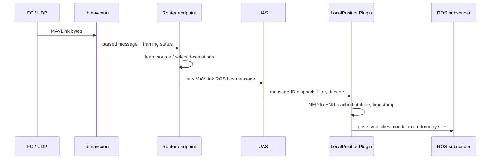

# Trace 1: Position telemetry

October 28, 2026. Primary path: one incoming `LOCAL_POSITION_NED` message through pinned MAVROS ROS 2 to application-visible pose/velocity. Comparison: the existing pArduBridge geographic-position path to MOOS navigation publications. These are comparable operating responsibilities, not identical measurements. See evidence for revisions, hashes, and source limits.

## 1. MAVROS receive sequence

| Stage | Verified source behavior | Consequence |
| --- | --- | --- |
| Receive bytes | UDP `async_receive_from` calls `parse_buffer`, then rearms receive | Source network endpoint and MAVLink system/component identity are separate |
| Parse | libmavconn emits the message and framing status when parsing is no longer incomplete | A raw callback is not itself proof that the payload is valid for a functional plugin |
| Learn and route | Endpoint records source system/component addresses; Router reads target metadata when present, skips same endpoint/type, and selects destinations | Untargeted telemetry can fan out; a UAS still needs source selection |
| Cross internal bus | ROS endpoint wraps the MAVLink frame; UAS subscribes to its bus and converts it back | Transport and application-facing plugin are separate boundaries even inside one process |
| Dispatch/decode | Plugin registers message handlers; UAS indexes by message ID; typed handler applies its filter before decode | The selected handler uses `SystemAndOk`: framing OK and matching source system |
| Convert/publish | LocalPositionPlugin constructs pose/twists/odometry and optional TF | One MAVLink message can generate several application publications |

Sources: MR01, MR02, MR03, MR04.

`SystemAndOk` does not require a matching source component or test authority to control anything. The Router's targeting/fallback behavior is also not an authentication mechanism. A multi-component or multi-vehicle design must identify which observations are acceptable independently of which link received them.

## 2. Quantities, frames, and cached dependencies

`LOCAL_POSITION_NED` supplies position `(north,east,down)`, velocity in the corresponding local frame, and a boot-time millisecond stamp. The source maps NED to ENU by swapping the horizontal axes and negating vertical. For example, input position `(10,20,-5)` becomes `(20,10,5)`. This is an axis conversion; it does not establish agreement between the FC's estimator origin and a MOOS mission's geographic origin. MR04, plugin 149–162 and conversion 63–69, 103–108.

The plugin additionally obtains orientation and angular velocity from UAS's cached attitude data. It uses the cached orientation to convert local linear velocity into the body frame. Position and attitude therefore need not be simultaneous samples. The inspected handler does not enforce a maximum age or timestamp match for that cache. UAS data starts with identity orientation and zero angular velocity; receiving position does not prove that a measured attitude has already arrived. These are source-level prerequisites a consumer must understand, not a claim that this path always produces invalid data. MR03, `uas_data.cpp` 29–47; MR04, plugin 164–179.

The pose frame defaults to `map`; the TF world/child defaults are `map` and `base_link`, with TF sending disabled by default. The body twist uses the child frame; local twist uses the configured position frame. These names are configuration labels, not automatic evidence of a particular physical origin or a valid transform history.

## 3. Time and output semantics

The odometry/pose header is built from `time_boot_ms` using `synchronized_header`. The time helper uses the known offset or passthrough mode when applicable and the stamp is representable; otherwise it returns current ROS time. Thus the header's timestamp is conditional on time-synchronization state, not an unconditional preservation of FC measurement time. The raw Router bus stamp is a different receive-side stamp. MR04, `uas_timesync.cpp` 38–54, UAS header 493–498.

For the selected NED handler:

- Pose and local/body velocities are published on each accepted message.
- Odometry is published only while `has_local_position_ned_cov` is false.
- TF is published if configured.
- Publishers use `SensorDataQoS`; this study does not derive a delivery or scheduling guarantee from that class name.

The companion covariance handler supplies odometry and other outputs. Its `has_*` flags mean a family has been received during the plugin instance, not that it is currently fresh. No age reset or connection callback is present in this inspected plugin. In particular, an earlier covariance message can suppress later non-covariance odometry even if covariance traffic subsequently stops. That is an architectural availability/freshness distinction worth carrying into the MAVMOOS design, rather than copying a simple “available” boolean. MR04, 181–213 and 216–285.

This trace did not validate covariance rotation, numeric sensor quality, estimator-reset handling, or TF consistency. Default-filled fields and a successfully published message are not sensor-quality evidence.

## 4. pArduBridge comparison path

The local bridge uses global position for its navigation publications. A representative receive chain is MAVSDK UDP parser → MavsdkImpl system dispatch → TelemetryImpl `GLOBAL_POSITION_INT` decode → user callback → `UAV_Model` state → MOOS Iterate publication. Source selection starts with `first_autopilot(3.0)` during bridge startup; that is a discovery policy, not a general multi-vehicle identity contract. PA02, SD01.

TelemetryImpl converts latitude/longitude from scaled integers, absolute/relative altitude from millimeters, and velocity from centimeters per second. Its position callback updates the model's thread-safe position object. Other callbacks update raw GPS course/speed and health. The MOOS thread reads these separately; mutual exclusion on individual values does not make position, raw GPS, and health one synchronized observation.

`postTelemetryUpdate` reads latitude/longitude, converts them with `LatLong2LocalGrid`, and publishes the configured prefix's LAT/LON/X/Y/SPEED/ALTITUDE/DEPTH/HEADING variables. The sampled mission sets `prefix=NAV`; a different configuration can use another prefix. Course-over-ground supplies HEADING, and relative altitude supplies ALTITUDE and negative DEPTH. This is a concrete application convention, not a general identity between yaw/course or altitude/depth. PA01, app 1638–1682, 1969–1984 and mission plug 3–15.

There are two important interpretation limits:

1. The AGL-named altitude getter returns `relative_altitude_m`. The inspected path does not establish terrain-relative height. A future interface should use the reference actually supported by the data.
2. Navigation values are republished with `m_curr_time`; the position callback does not retain an FC sample stamp/age in this path. A new MOOS publication does not prove a new position measurement arrived. Separate GPS/health age publications do not by themselves establish the age of every position quantity.

Also, the source tests `if (!lat || !lon)` before publication, which rejects valid zero latitude or longitude, while its later helper only suppresses NaNs. This bounded observation illustrates why numeric validity must be specified explicitly; it is not a complete audit or a change request to the existing project. PA01, 1641–1656; PA02, header 274.

## 5. Through MOOSDB to consumers

MOOSDB records the current value, original message time, source/auxiliary/community, and writers. It places eligible notifications in registered clients' mailboxes; a fetch can contain several updates to one variable. It can deliver a pre-existing value on registration. A consumer must therefore distinguish the current cached value, notification receipt, and producer measurement freshness. MO01, DB 704–838 and 925–968; manual extracted lines 140–161.

With `prefix=NAV`, conventional consumers such as helm behaviors and the marine PID can subscribe to familiar navigation variables. Their required meanings still matter: the inspected MarinePID consumes NAV_HEADING as current heading and NAV_SPEED as current speed, while the bridge publishes GPS course/speed. Whether that pairing is appropriate depends on vehicle/control intent. The bridge prefix alone does not guarantee interoperability. MO02, PID mail 71–85.

## 6. MAVMOOS implications and later checks

Proposed requirements derived from this trace:

- Define observation identity separately from routing and command authority.
- Preserve sample time, receipt time, and publication time, or state clearly when each is unknown.
- Label local origin and vertical reference explicitly; an ENU axis convention is not origin alignment.
- Expose validity/age per observation family. Do not convert “ever received” or “recently republished” into “fresh.”
- Distinguish yaw, course-over-ground, and their suitability for a particular controller.
- Decide how compound observations coexist with convenient scalar NAV variables, including consistency across publications.

Later verification should exercise nonzero and zero geographic coordinates, missing/stale attitude, FC local-origin reset, loss of one telemetry family while others remain live, covariance-stream disappearance, delayed MOOS registration, and observation versus publication timestamps. These cases are proposed from source analysis; no runtime validation was performed.
