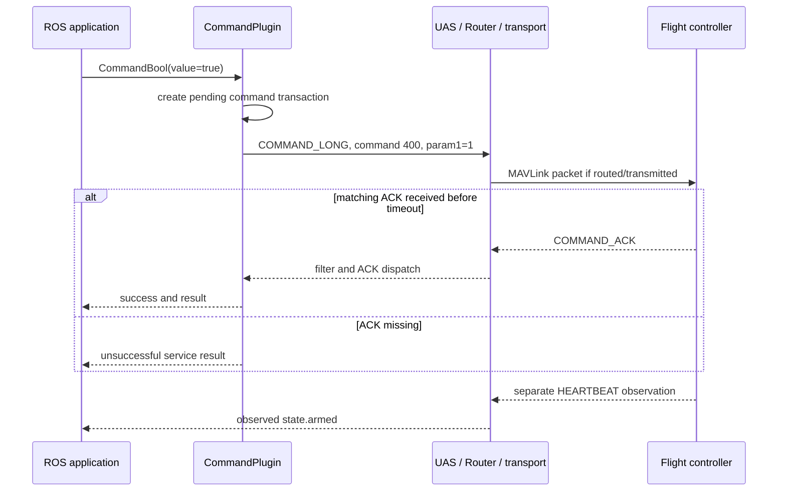

# Trace 2: An acknowledged ARM request

October 28, 2026. Selected command: ordinary, targeted `MAV_CMD_COMPONENT_ARM_DISARM` with arm value true. This command gives an unambiguous MAVROS ACK path. The related `SetMode` service is examined separately because its response has different semantics. This is a static analysis only; no arming request was sent. Evidence and scope.

## 1. MAVROS transaction sequence

The service response and observed armed state are intentionally drawn as separate paths. The service callback does not wait for the state publication to confirm arming. MR05.

## 2. Request entry, serialization, and target

The plugin creates `~/arming` with `CommandBool` in a mutually exclusive callback group shared with its other command services. The request contains a boolean; the response contains `success` and the MAVLink result byte. `arming_cb` calls the common helper with broadcast false, command `COMPONENT_ARM_DISARM`, confirmation 1, param1 equal to 1 or 0, and remaining parameters zero. This is not the force-arm variant. MR05, services 88–116, callback 433–445.

Before sending, the helper checks a list of outstanding command numbers. An identical command number already pending is rejected as temporarily rejected. Because these services share a mutually exclusive group, ROS service-callback concurrency is also constrained; the list is not a general scheduler for arbitrary concurrent application transactions.

For this targeted ARM request, ACK wait is required. The helper registers a transaction, constructs `COMMAND_LONG`, fills target system/component from the UAS target configuration (or the configured system-control component override), and calls `uas->send_message`. UAS serializes/finalizes using source system/component IDs, publishes on the raw sink bus, and the Router forwards toward the FC endpoint. MR05, 246–303 and 333–370; MR02, 454–475.

The UDP sender may drop because a peer is unknown or the channel is closed; queue overflow is logged by the ignore-drop wrapper. The plugin's send call is not a wire-delivery receipt. The ACK is a stronger observation when one arrives. MR01.

## 3. ACK matching and waiting

The incoming ACK follows the transport/Router/UAS path from trace 1. The command plugin uses `SystemAndOk`, then matches the decoded ACK against the pending command number. It sets the transaction's promise to `ack.result`; an already-satisfied promise is logged and an unexpected command is warned about. The inspected handler does not match an application UUID, source component, or ACK target fields. The UAS system filter provides part of the correlation boundary. MR03, MR05, 199–223.

The service waits on a future for the configured timeout, default five seconds in this source. The mutex is released during the wait, allowing the ACK handler to satisfy the promise. Service completion still depends on the execution environment being able to dispatch the ACK while the callback waits; this study does not establish worst-case scheduling latency.

If ready, success is true only when the first received result is ACCEPTED. If not ready, success is false and the transaction is removed. The inspected helper sends once and has no retransmission loop. An external caller may retry, but that would be a new policy, not a guarantee of this helper. A late ACK can arrive after the transaction has been erased; reusing the same command number leaves correlation ambiguity that an internal application ID alone cannot eliminate.

An IN_PROGRESS ACK also satisfies the promise; this helper then returns success false because the result is not ACCEPTED. It does not preserve a long-running transaction for later progress/final ACKs. That is a source-specific difference from the fuller [MAVLink command protocol](https://mavlink.io/en/services/command.html), which describes progress and retransmission. Do not treat the plugin's “implements command protocol” description as a guarantee that every protocol feature is present. MR05, 227–303.

On timeout, a consumer must interpret `success` together with the validity of any result value. A timeout is uncertainty about outcome, not proof that the FC never acted. Retrying an operation requires operation-specific duplicate and observation rules.

## 4. What confirms the requested state?

The separate system-status plugin receives target heartbeat, updates UAS connection/type state, and publishes armed/guided/manual/mode fields derived from the heartbeat flags and mode. `state.armed` is an observation of the reported state; it is not a response correlated to a particular ARM request. A client needing confirmation must combine that observation with appropriate identity, timing, and transaction context. MR05, sys-status 933–987.

This avoids conflating four facts:

| Fact | What it establishes | What it does not establish |
| --- | --- | --- |
| Request accepted by bridge API | A local operation was admitted | FC received it |
| Command queued/sent | A send path was invoked | FC accepted it |
| ACCEPTED ACK | FC accepted the command for action | Physical completion or continued state |
| Observed armed heartbeat | FC reports armed at observation time | Which caller caused it, propulsion readiness, or permission for navigation |

No source trace into autopilot pre-arm checks, actual motor output, or vehicle readiness was performed.

## 5. pArduBridge comparison

The bridge registers `ARM_UAV`. Its mail handler parses a string boolean into one optional pending arm/disarm request. Iterate consumes the optional and calls `requestArmAsync` or `requestDisarmAsync`, then resets it. Multiple mail updates before that consumption can collapse into the final value; this is not a per-message request queue with caller-supplied IDs. PA01, 229–239 and 583–594.

`requestArmAsync` first evaluates bridge policy. It handles already-armed as a no-op; otherwise it checks available/fresh health, armable/all-health status, available/fresh landed state, and ON_GROUND. Allowed requests receive a bridge-generated result ID and SUBMITTED status. The call then invokes MAVSDK's asynchronous arm API directly from this dispatch path. The bridge's own command-sender thread is not the obligatory route for this operation. PA02, 378–398, 489–505, 522–539, 1501–1516.

The pinned SDK Action implementation builds the same ARM command, chooses the autopilot component, and delegates to its command sender. Depending on cached flight mode it may first request Hold; this high-level API can therefore involve more than a raw ARM packet. The SDK sender checks ACK addressing and target source identity more specifically than the selected MAVROS helper, retains IN_PROGRESS work, and has a timeout/retry path. These are observations of this fork/revision, not a claim about every MAVSDK release. SD01.

On SDK Success, pArduBridge reports ACCEPTED; otherwise FAILED. The selected ARM callback does not create a subsequent armed-state CONFIRMED lifecycle event. Armed telemetry exists separately. Other operations use mode/takeoff confirmation trackers, so the bridge's general lifecycle vocabulary must be interpreted per operation.

The callback enqueues a result for the MOOS thread. `postCommandResult` publishes at most one queued item per Iterate as `id,command,status,detail` on `UAV_COMMAND_RESULT`. The ID is assigned inside the bridge; the original issuer/target/request/session are not part of this request interface. The latest DB result cannot reconstruct the full history, although subscribers/logging may receive successive result notifications. PA01, 1790–1817; PA02, 1406–1419.

## 6. Set-mode and confirmation are different contracts

The inspected MAVROS `SetMode` path parses the mode, sends `SET_MODE`, and sets `mode_sent=true`. It does not wait for COMMAND_ACK or matching heartbeat. The COMMAND_INT service similarly reports send-path completion without ACK waiting, despite command-protocol documentation discussing acknowledgments for COMMAND_INT. These paths must not be wrapped in the same “confirmed” abstraction. MR05.

pArduBridge's ModeConfirmationTracker uses an expected-mode boolean over monotonic dwell/timeout, and the Guided handoff poll additionally checks fresh Copter intent. That is a useful distinct observation stage, but the inspected helper does not itself require a newly received mode sample on every evaluation. Dwell over a cached boolean is not necessarily freshness of FC telemetry. The larger authority design must define observation age and restart/override behavior explicitly. PA02, tracker 25–65; PA01, 1515–1559.

## 7. MOOS-specific replay and result requirements

The inspected DB delivers an existing value on registration. A restarting subscriber can therefore see a retained `ARM_UAV=true`. In this bridge's selected mail branch there is no request nonce, original-message expiry check, or caller identity validation beyond the general self-message exclusion. The bridge's policy may reject it or return a no-op, but retained state alone does not represent a new authorized request. This is a conditional source-derived replay scenario, not a reproduced incident. MO01, PA01.

For MAVMOOS, propose separate bridge admission, protocol result, observed-state confirmation, and task completion. Define issuer/target/session identity, request IDs, expiry, duplicate semantics, result ordering, timeout uncertainty, and reconnect recovery. Avoid re-executing a command merely because it was re-forwarded or received during registration. Preserve FC rejection rather than promising the bridge can reproduce all preconditions.

Later checks should cover ACK-before/after timeout, duplicate requests, ACK from another component, lost ACK after action, IN_PROGRESS then final result, request burst, reconnect with retained command state, and a delayed result subscriber. These remain planned validation cases; no implementation or tests were added.
