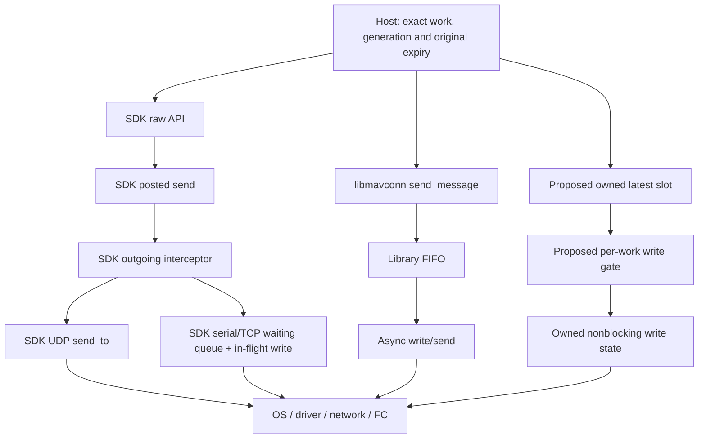

# Source traces: receive evidence, retries and egress

October 29, 2026. Static analysis at the revisions in the manifest. “Current SDK” means the inspected main-branch research snapshot, not a selected dependency/release. Conclusions below are limited to the named APIs/transports. The proposed direct-I/O path does not exist in MAVMOOS.

## 1. Ingress and observation age

### MAVSDK typed and raw paths

The fork's [heartbeat handler](https://github.com/Scarter668/MAVSDK/blob/e8ff09a5dada80ccded46e28df0395c917d2d997/src/mavsdk/plugins/telemetry/telemetry_impl.cpp#L1267-L1291) and current SDK's [handler](https://github.com/mavlink/MAVSDK/blob/8b1ad926a879a72aefe0e66f606e0349f8186f28/cpp/src/mavsdk/plugins/telemetry/telemetry_impl.cpp#L1355-L1383) queue armed, mode and aggregate health callbacks when target-autopilot heartbeats are processed. They are not uniformly value-change-only subscriptions. However, the callback arguments do not provide an immutable packet-receipt envelope; receiving a callback later is different from receiving the underlying packet then.

Two particularly relevant transformations in the current SDK:

- [Global position conversion 787–829](https://github.com/mavlink/MAVSDK/blob/8b1ad926a879a72aefe0e66f606e0349f8186f28/cpp/src/mavsdk/plugins/telemetry/telemetry_impl.cpp#L787-L829) copies latitude/longitude, MSL/relative height, NED velocity and heading into separate values. That conversion does not carry `GLOBAL_POSITION_INT.time_boot_ms` into those position/velocity callback values. Other SDK telemetry types may carry timestamps; this finding is specific to the inspected profile path.
- [EKF conversion 1242–1272](https://github.com/mavlink/MAVSDK/blob/8b1ad926a879a72aefe0e66f606e0349f8186f28/cpp/src/mavsdk/plugins/telemetry/telemetry_impl.cpp#L1242-L1272) updates cached position-health flags from an estimator report. The heartbeat handler later republishes `health()` without a new EKF report. Timestamping every health callback as fresh estimator evidence would therefore renew an old fact incorrectly. An aggregate also includes pre-arm/home/calibration facts with different update semantics.

The [extended-state handler 1116–1146](https://github.com/mavlink/MAVSDK/blob/8b1ad926a879a72aefe0e66f606e0349f8186f28/cpp/src/mavsdk/plugins/telemetry/telemetry_impl.cpp#L1116-L1146) publishes the landed-state enum, but also derives an `in_air` boolean that combines IN_AIR, TAKEOFF and LANDING and preserves its prior value when the report is undefined. The profile requires fresh **IN_AIR**, not this broader boolean.

Current SDK [receive dispatch 726–739](https://github.com/mavlink/MAVSDK/blob/8b1ad926a879a72aefe0e66f606e0349f8186f28/cpp/src/mavsdk/core/mavsdk_impl.cpp#L726-L739) normally processes parsed packets on its I/O executor. [User callback delivery 1760–1838](https://github.com/mavlink/MAVSDK/blob/8b1ad926a879a72aefe0e66f606e0349f8186f28/cpp/src/mavsdk/core/mavsdk_impl.cpp#L1760-L1838) introduces another executor/queue, with different handling for droppable telemetry versus nondroppable callbacks. A custom callback executor can reduce/control that handoff but does not recreate source times or estimator-report provenance.

The raw Passthrough [receive method 222–227](https://github.com/mavlink/MAVSDK/blob/8b1ad926a879a72aefe0e66f606e0349f8186f28/cpp/src/mavsdk/plugins/mavlink_passthrough/mavlink_passthrough_impl.cpp#L222-L227) also queues the raw message to user callbacks. Thus “raw” does not itself mean “stamped at parse.” Incoming interception, or another qualified adapter/receive integration, must retain an earlier timestamp and actual target/report identity before a later host hop. Current SDK exposes JSON interception; the older C interception remains deprecated and intended primarily for testing. No production adapter around either was built here.

For the profile's two-report Guided confirmation, retain two distinct qualifying target heartbeat observations, their ingress times, mode/armed fields and contradiction history. Polling the same SDK getter twice, or receiving two delayed callbacks close together, cannot establish the proposed observation span/current-age requirements. Raw receipt also needs duplicate/reconnect handling; packet sequence alone is not an incarnation proof.

### libmavconn

The [receive API](https://github.com/mavlink/mavros/blob/2d3f4db1101c7950c8817a9d788f0d11106fb261/libmavconn/include/mavconn/interface.hpp#L117-L120) supplies a message pointer and framing result, without a built-in receive timestamp. [Parsing 112–137](https://github.com/mavlink/mavros/blob/2d3f4db1101c7950c8817a9d788f0d11106fb261/libmavconn/src/interface.cpp#L112-L137) calls it on non-incomplete frames, including bad CRC/signature results. The adapter must admit only valid/allowed framing, apply target/source policy, copy the transient message data and stamp monotonic acquisition before its own event queue. No MOOS/profile health policy or clock mapping is supplied by the transport.

This is a simpler evidence boundary than a typed cached value. It still cannot recover time spent in upstream routers, kernel buffers or delayed I/O execution. Interpret available FC sample times separately; preserve “unknown physical sample age” where mapping is not qualified.

### Direct generated MAVLink

The [parser](https://github.com/mavlink/c_library_v2/blob/a2d0ecf011a4aaa7840480e43f4e38d8c9e79d29/mavlink_helpers.h#L697-L725) and [parse wrapper](https://github.com/mavlink/c_library_v2/blob/a2d0ecf011a4aaa7840480e43f4e38d8c9e79d29/mavlink_helpers.h#L1185-L1212) can be driven inside owned I/O. MAVMOOS would own stamping, per-channel parser state, valid-frame filtering, duplicate/session treatment and event transfer. Using generated code avoids hand-writing the wire codec; it does not supply vehicle discovery, health interpretation, authority or bounded scheduling.

## 2. Guided acquisition and command retries

### pArduBridge and its fork

The reference [handoff request](https://github.com/cbenjamin23/moos-ivp-uav-base/blob/e34a62ef49c2be42215a69c351850cbd85881486/src/pArduBridge/ArduBridge.cpp#L2035-L2062) queues a model operation, calls the Guided helper, then starts later mode confirmation. The model's own [sender loop](https://github.com/cbenjamin23/moos-ivp-uav-base/blob/e34a62ef49c2be42215a69c351850cbd85881486/src/pArduBridge/UAV_Model.cpp#L2111-L2155) executes queued operations before the navigation callback/sleep. Blocking operation work can therefore delay the nominal sender independently of SDK internals. The profile tightened its deadline to admission; that is a proposed improvement, not a property inherited from this loop.

The fork command sender's [work record](https://github.com/Scarter668/MAVSDK/blob/e8ff09a5dada80ccded46e28df0395c917d2d997/src/mavsdk/core/mavlink_command_sender.h#L113-L123) stores three retries. Its [timeout path](https://github.com/Scarter668/MAVSDK/blob/e8ff09a5dada80ccded46e28df0395c917d2d997/src/mavsdk/core/mavlink_command_sender.cpp#L293-L347) retransmits the stored command while retries remain. There is no per-request generation/absolute deadline/cancel API in that sender's inspected public surface. A MAVMOOS/pArduBridge-level timeout or ignored callback does not remove this work.

### Current upstream SDK

The [current sender API 26–28 and 84–97](https://github.com/mavlink/MAVSDK/blob/8b1ad926a879a72aefe0e66f606e0349f8186f28/cpp/src/mavsdk/core/mavlink_command_sender.hpp#L26-L97) exposes an internal retry count, default three, and a ten-second in-progress timeout. Work is [posted/queued 89–166](https://github.com/mavlink/MAVSDK/blob/8b1ad926a879a72aefe0e66f606e0349f8186f28/cpp/src/mavsdk/core/mavlink_command_sender.cpp#L89-L166). [do_work 446–497](https://github.com/mavlink/MAVSDK/blob/8b1ad926a879a72aefe0e66f606e0349f8186f28/cpp/src/mavsdk/core/mavlink_command_sender.cpp#L446-L497) defers another active command with the same command ID, then starts send-time timeout handling. [Timeout 346–438](https://github.com/mavlink/MAVSDK/blob/8b1ad926a879a72aefe0e66f606e0349f8186f28/cpp/src/mavsdk/core/mavlink_command_sender.cpp#L346-L438) retries stored work; this is not an absolute admission deadline. The in-progress path is relevant to broader service transactions, not proof that a Guided request normally needs that long.

MavlinkDirect is not synonymous with bypassing command management: [send_command_async 225–379](https://github.com/mavlink/MAVSDK/blob/8b1ad926a879a72aefe0e66f606e0349f8186f28/cpp/src/mavsdk/plugins/mavlink_direct/mavlink_direct_impl.cpp#L225-L379) decodes COMMAND_LONG/INT and uses the same SystemImpl command sender, while exposing a final ACK to its result callback. Passthrough's [send_command helpers 56–93](https://github.com/mavlink/MAVSDK/blob/8b1ad926a879a72aefe0e66f606e0349f8186f28/cpp/src/mavsdk/plugins/mavlink_passthrough/mavlink_passthrough_impl.cpp#L56-L93) also use command management. Sending an encoded command through a generic `send_message` path avoids that helper's automatic retries but then requires host-owned ACK/result/retry handling; it is not reliable command handling for free.

The inspected high-level public APIs do not expose the host's epoch, absolute deadline and selective cancel handle for that command work. The internal configurable retry parameter is not equivalent to such a public contract. An outgoing filter can suppress later attempts, subject to the association/settlement limitations below.

### Shared protocol limits

The [pinned command guide 43–56](https://github.com/mavlink/mavlink-devguide/blob/b6d83e20c397f05e634986d400ddb1b42385fa19/en/services/command.md#L43-L56) describes ACK/retry delivery. libmavconn and the generated headers do not implement that transaction state machine; MAVMOOS would need to supply it. Policy can bound attempts and stop them on revocation, while reporting timeout/unknown rather than claiming delivery.

The standard [ACK record](https://github.com/mavlink/c_library_v2/blob/a2d0ecf011a4aaa7840480e43f4e38d8c9e79d29/common/mavlink_msg_command_ack.h#L9-L16) contains command/result/progress/recipient fields, without a MAVMOOS request-generation nonce. The current SDK [matches ACKs by command/target 170–226](https://github.com/mavlink/MAVSDK/blob/8b1ad926a879a72aefe0e66f606e0349f8186f28/cpp/src/mavsdk/core/mavlink_command_sender.cpp#L170-L226). A late ACK after a similar new request is not automatically causally attributable. Avoid overlapping conflicting operations, retain ambiguous history and use fresh observed native mode independently of ACK status.

The [cancellation guide 107–122](https://github.com/mavlink/mavlink-devguide/blob/b6d83e20c397f05e634986d400ddb1b42385fa19/en/services/command.md#L107-L122) permits unsupported remote cancellation to continue and completed/idle cancellation to be ignored. COMMAND_CANCEL is not a local queue API or a generic undo. The profile's SET_POSITION_TARGET messages are not ordinary ACK-managed commands. No firmware-specific cancellation capability has been qualified.

## 3. Navigation egress and queues

This compares inspected paths with a proposed direct path; it is not a running architecture. Every arrow can introduce delay. Only the SDK path shown has the inspected SDK interceptor; downstream queues are outside its per-message recheck.

### MAVSDK helpers versus raw sends

The current [Offboard velocity setter 176–199](https://github.com/mavlink/MAVSDK/blob/8b1ad926a879a72aefe0e66f606e0349f8186f28/cpp/src/mavsdk/plugins/offboard/offboard_impl.cpp#L176-L199) stores a setpoint, schedules periodic sending and sends immediately. The [interval is 0.05 s](https://github.com/mavlink/MAVSDK/blob/8b1ad926a879a72aefe0e66f606e0349f8186f28/cpp/src/mavsdk/plugins/offboard/offboard_impl.hpp#L102), independently of the profile's proposed ten-Hz owner. Its [velocity packet 494–535](https://github.com/mavlink/MAVSDK/blob/8b1ad926a879a72aefe0e66f606e0349f8186f28/cpp/src/mavsdk/plugins/offboard/offboard_impl.cpp#L494-L535) always includes yaw; it does not implement the profile's yaw-ignore-at-low-speed switch.

[start/stop 45–104](https://github.com/mavlink/MAVSDK/blob/8b1ad926a879a72aefe0e66f606e0349f8186f28/cpp/src/mavsdk/plugins/offboard/offboard_impl.cpp#L45-L104) requires a prepared setpoint and requests Offboard/Hold. In the current [Copter mapping 1071–1107](https://github.com/mavlink/MAVSDK/blob/8b1ad926a879a72aefe0e66f606e0349f8186f28/cpp/src/mavsdk/core/system_impl.cpp#L1071-L1107), those mean Guided and **Brake**, respectively. A familiar SDK label cannot be substituted for the profile's native LOITER/GUIDED entry allowlist or conditional position-target response. Mode/heartbeat watchdogs in the helper do not know MOOS per-field expiry. Default helper use would therefore change acquisition, scheduling, yaw and loss semantics.

Raw send APIs allow the exact profile packets without enabling this repeater. Current [ServerComponent packing 219–227](https://github.com/mavlink/MAVSDK/blob/8b1ad926a879a72aefe0e66f606e0349f8186f28/cpp/src/mavsdk/core/server_component_impl.cpp#L219-L227) invokes the builder immediately, but [send_message/deliver_message 1102–1190](https://github.com/mavlink/MAVSDK/blob/8b1ad926a879a72aefe0e66f606e0349f8186f28/cpp/src/mavsdk/core/mavsdk_impl.cpp#L1102-L1190) posts the resulting packet. Return true means queued. A builder's current timestamp/check is therefore earlier than actual delivery.

After interception, current [UDP 171–245](https://github.com/mavlink/MAVSDK/blob/8b1ad926a879a72aefe0e66f606e0349f8186f28/cpp/src/mavsdk/core/udp_connection.cpp#L171-L245) calls synchronous socket send; it has no inspected intermediate async transmit FIFO on that path, but no demonstrated send-time upper bound. [Serial 277–355](https://github.com/mavlink/MAVSDK/blob/8b1ad926a879a72aefe0e66f606e0349f8186f28/cpp/src/mavsdk/core/serial_connection.cpp#L277-L355) and [TCP client 126–181](https://github.com/mavlink/MAVSDK/blob/8b1ad926a879a72aefe0e66f606e0349f8186f28/cpp/src/mavsdk/core/tcp_client_connection.cpp#L126-L181) instead put bytes into bounded queues before async write. [TxQueue](https://github.com/mavlink/MAVSDK/blob/8b1ad926a879a72aefe0e66f606e0349f8186f28/cpp/src/mavsdk/core/tx_queue.hpp#L10-L70) drops oldest waiting items only at capacity; it has no deadline/generation field and `clear()` deliberately leaves an in-flight item intact. This improves bounded-memory behavior but does not enforce 0.10 s work age or selective old-generation cancellation.

### libmavconn

The public [send/close API](https://github.com/mavlink/mavros/blob/2d3f4db1101c7950c8817a9d788f0d11106fb261/libmavconn/include/mavconn/interface.hpp#L145-L201) supplies no per-frame deadline, cancellation handle or completion receipt. The [queue limit is 1,000](https://github.com/mavlink/mavros/blob/2d3f4db1101c7950c8817a9d788f0d11106fb261/libmavconn/include/mavconn/interface.hpp#L319-L323). [UDP insertion 227–263](https://github.com/mavlink/mavros/blob/2d3f4db1101c7950c8817a9d788f0d11106fb261/libmavconn/src/udp.cpp#L227-L263) copies a frame, throws on overflow and posts the send chain. [Write selection 350–419](https://github.com/mavlink/mavros/blob/2d3f4db1101c7950c8817a9d788f0d11106fb261/libmavconn/src/udp.cpp#L350-L419) drains FIFO order without expiry/authority checks. Some transient UDP errors drop a datagram rather than retry the command protocol.

[Serial 192–244](https://github.com/mavlink/mavros/blob/2d3f4db1101c7950c8817a9d788f0d11106fb261/libmavconn/src/serial.cpp#L192-L244) and [TCP 238–295](https://github.com/mavlink/mavros/blob/2d3f4db1101c7950c8817a9d788f0d11106fb261/libmavconn/src/tcp.cpp#L238-L295) have the same FIFO admission shape; their async-write chains handle partial transport writes, not application-level retries. Small queue capacity alone cannot bound delay on a stalled link. Reducing the limit would not establish selective expiry or latest-target replacement.

UDP closed/no-remote paths return without an emission; a void return is not a delivery receipt. [send_message_ignore_drop 171–198](https://github.com/mavlink/mavros/blob/2d3f4db1101c7950c8817a9d788f0d11106fb261/libmavconn/src/interface.cpp#L171-L198) logs/swallows overflow exceptions, so that convenience method must not be used as successful profile handoff evidence. Close cancels socket/device operations ([UDP 173–193](https://github.com/mavlink/mavros/blob/2d3f4db1101c7950c8817a9d788f0d11106fb261/libmavconn/src/udp.cpp#L173-L193)); it is a coarse connection action, not selective navigation cancellation or recall of transmitted bytes.

### Direct I/O proposal

The generated [buffer encoder 525–585](https://github.com/mavlink/c_library_v2/blob/a2d0ecf011a4aaa7840480e43f4e38d8c9e79d29/mavlink_helpers.h#L525-L585) and [UART send integration 1230–1243](https://github.com/mavlink/c_library_v2/blob/a2d0ecf011a4aaa7840480e43f4e38d8c9e79d29/mavlink_helpers.h#L1230-L1243) demonstrate codec/application-I/O separation. MAVMOOS could retain its work envelope until an owned write gate, select only the latest waiting navigation target, and reject it on exact-work expiry/generation mismatch before emission. That removes one opaque queue layer; the proposed I/O still needs bounded resources, nonblocking/backpressure policy and accurate completion/error records.

Serial/TCP must distinguish unsent complete frames from an already partially emitted frame. Discarding remaining bytes or inserting another frame mid-write is not a clean cancellation contract. Finish/abort policy and residual uncertainty must be explicit. UDP datagram handling does not qualify stream transports. No source library can recall bytes already accepted by the OS/driver/router/FC, and no direct transport has been built or measured here.

## 4. SDK interceptors, forwarding and version differences

Current outgoing interception executes in `deliver_message`, after posted-send delay and before connection submission. [Public JSON hooks/C-API deprecation 640–742](https://github.com/mavlink/MAVSDK/blob/8b1ad926a879a72aefe0e66f606e0349f8186f28/cpp/src/mavsdk/core/include/mavsdk/mavsdk.hpp#L640-L742) and [callback invocation 1129–1162](https://github.com/mavlink/MAVSDK/blob/8b1ad926a879a72aefe0e66f606e0349f8186f28/cpp/src/mavsdk/core/mavsdk_impl.cpp#L1129-L1162) make a late drop possible. The C hook is deprecated/compile-guarded; the current JSON hook is the supported alternative in that header. An adapter must assess its cost and lifetime/thread behavior rather than silently depending on a testing hook.

Four remaining boundaries:

1. **Association:** the interceptor sees a message, without a MAVMOOS request token. It needs a proven association with exact work or a quiescence barrier. A fresh global permission bit cannot authorize arbitrary older queued payloads.
2. **Downstream:** it runs before serial/TCP waiting queues. It cannot selectively purge those public-API buffers or recall in-flight data.
3. **Results:** a filtered send is treated as dropped traffic, not a per-request cancelled completion. The host must report its own rejection evidence and not wait for a misleading SDK success/result.
4. **Topology/threading:** current [forwarding 683–724](https://github.com/mavlink/MAVSDK/blob/8b1ad926a879a72aefe0e66f606e0349f8186f28/cpp/src/mavsdk/core/mavsdk_impl.cpp#L683-L724) calls connection sends directly rather than this common outgoing gate. Disable unmanaged forwarding for the controlled path or account for it as external traffic. Interceptors execute amid SDK locks/I/O processing; use bounded snapshot/event operations and avoid blocking SDK calls or synchronous connection shutdown inside them.

The fork's [packing 164–172](https://github.com/Scarter668/MAVSDK/blob/e8ff09a5dada80ccded46e28df0395c917d2d997/src/mavsdk/core/server_component_impl.cpp#L164-L172) and [send path 411–477](https://github.com/Scarter668/MAVSDK/blob/e8ff09a5dada80ccded46e28df0395c917d2d997/src/mavsdk/core/mavsdk_impl.cpp#L411-L477) call the outgoing filter/connections synchronously, unlike the current posted path. Its [serial write 252–284](https://github.com/Scarter668/MAVSDK/blob/e8ff09a5dada80ccded46e28df0395c917d2d997/src/mavsdk/core/serial_connection.cpp#L252-L284) and TCP/UDP sends use synchronous system calls rather than the current async serial/TCP queue. Neither version has a demonstrated deadline bound. The old fork is useful reference evidence; it must not be presented as today's upstream public API or as a required MAVMOOS dependency.

libmavconn's [README](https://github.com/mavlink/mavros/blob/2d3f4db1101c7950c8817a9d788f0d11106fb261/libmavconn/README.md) describes use outside ROS, while its [build file 10–54](https://github.com/mavlink/mavros/blob/2d3f4db1101c7950c8817a9d788f0d11106fb261/libmavconn/CMakeLists.txt#L10-L54) requires ament, C++20, Asio, console_bridge and MAVLink. That supports considering transport reuse without copying ROS nodes; it does not prove a dependency-free standalone/macOS build. No installation/build/platform experiment or license-selection decision was performed.
