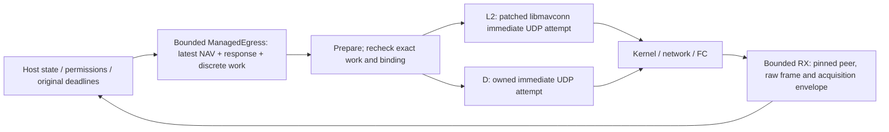

# Direct UDP scope, comparison and review cases

October 29, 2026. Proposed architecture, not an implemented backend. [Assessment](README.md), [common queue/fence semantics](queue-and-fence-design.md) and [source evidence](evidence.md). The first peer/platform/firmware is unselected; all timing values remain draft candidates.

## 1. What “small direct UDP” means

For this comparison, D owns one IPv4 UDP socket, one configured peer binding and one Copter context. It uses generated MAVLink framing/parser/signing facilities and can use Asio for lifecycle/read readiness and nonblocking socket calls. A transport adapter need not reimplement either library. Binding/rebinding is explicit; ordinary RX never chooses the next TX destination.

Keep the following in shared MAVMOOS host/modules for **both** D and L2: helm adaptation, the Copter control law, original validity/deadline computation, observation interpretation, acquisition state, ACK/transaction handling, retry policy, latest-work scheduling and authority/fence coordination. Direct UDP does not mean rebuilding these inside a second backend. libmavconn does not supply those vehicle/service policies either.

The narrow scope trades URL/discovery/broadcast/multiple-link/stream-transport breadth for a smaller controlled transport path. These are boundaries of a candidate, not implemented support or a permanent exclusion from MAVMOOS. A deployment needing that breadth can change the comparison.

The diagram shows proposed responsibilities, not existing executables or a new process boundary. For L1, the managed waiting/active queue and final gate live in the library extension under equivalent policy; it must not create a second independent repeater/retry engine.

## 2. Owned UDP path

1. **Open and bind:** resolve/configure endpoints before active control, bind a fresh local connection/peer epoch, initialize per-binding parser/TX channel state and begin receiving. Socket readiness does not authorize navigation. Retain enough identity/home/clock evidence for the existing supervisor to decide eligibility.
2. **Receive:** timestamp a successful datagram read/completion once, before parsing or host dispatch; retain source endpoint and datagram identity. Admit allowed peer/framing/target reports and copy them into bounded events. Preserve FC sample fields where supplied and keep physical source-age uncertainty explicit. A timestamp at this boundary still follows any kernel/network waiting.
3. **Bound parsing:** support valid multi-frame datagrams within a declared datagram budget, with a clear truncation/oversize/error policy. Avoid combining parser state across a different peer/session. Bound RX batch work/logging so continuous traffic cannot indefinitely postpone TX, fences or watchdog checks. An oversized/truncated report must not refresh a required observation merely because bytes arrived.
4. **Prepare/send:** on the single egress owner, select one eligible work item, prepare a complete addressed frame through owned codec state, recheck its exact eligibility, then make one nonblocking datagram attempt. There is no intermediate backend send FIFO or background resend timer. Record call-start/return evidence with the same work ID.
5. **Handle result:** publish a named local outcome; return control without an inline wait/retry loop. The host decides whether a later, separately eligible attempt is allowed. It must use the original deadline and operation budget.
6. **Fence/close:** revoke waiting/future work under the common owner boundary. Keep receiving during routine control revocation. Closing/rebinding is a separate connection operation with a new epoch and invalidated readiness; callbacks/events from the old epoch cannot authorize the new one.

The generated [frame-buffer encoder](https://github.com/mavlink/c_library_v2/blob/a2d0ecf011a4aaa7840480e43f4e38d8c9e79d29/mavlink_helpers.h#L525-L585) and [caller-owned parser state API](https://github.com/mavlink/c_library_v2/blob/a2d0ecf011a4aaa7840480e43f4e38d8c9e79d29/mavlink_helpers.h#L697-L725) provide concrete reusable primitives. Dialect/version, framing acceptance, signing configuration/state across restart, system/component addressing and timestamp conventions still require an explicit implementation choice. Packet sequence/signing fields are not substituted for MAVMOOS work IDs or control-generation metadata.

Local datagram/frame IDs distinguish receipt events, not fresh remote production. Duplicate/replay treatment, sequence wrap and delayed packets remain separate concerns, especially for heartbeat reports without sample time. Do not make two callbacks or two delayed copies satisfy the Guided-report rule merely by assigning new local IDs. The actual path's receipt-age assumptions still need qualification.

## 3. Nonblocking result policy

The [POSIX sendto reference](https://man7.org/linux/man-pages/man3/sendto.3p.html) distinguishes local errors/socket acceptance from delivery, with would-block behavior for a nonblocking socket. This is API context, not qualification of the eventual platform. Nonblocking mode avoids waiting for buffer space; scheduling/preemption can still delay a call and its observation.

| Local result | Proposed interpretation |
| --- | --- |
| Full datagram accepted | LOCAL_ACCEPTED with byte count and attempt interval; not FC receipt/ACK/tracking or proof that downstream queues are empty |
| Would block / buffer pressure | Not a successful handoff; do not advance the successful-handoff evidence or renew work/input expiry |
| Closed/no configured peer | Explicit local rejection, with no destination learning or silent success |
| Other local error | Report the precise error/attempt; supervisor decides readiness/loss implications without inventing an FC outcome |
| Unexpected short successful datagram result | Transport anomaly with explicit residual uncertainty; do not send a suffix as a second datagram |
| Call/completion observed after a candidate budget | Record the overrun and apply the profile's inhibition/recovery policy; do not relabel an accepted packet as unsent |

For NAV, a would-block item is not automatically retried by the transport. A later normal host tick may select new work from still-current inputs, preserving their original expiries. A loss response has its separate bounded one-attempt permit; failure does not authorize an indefinite write-readiness loop or a new mode change. For a discrete mode attempt, local-attempt count, known local acceptance and any allowed protocol retry are distinct ledger facts. This study does not silently settle the earlier open “request Guided once” interpretation.

For D/L2 there is no managed asynchronous TX item left waiting in the backend after the immediate call returns, although accepted bytes remain downstream. For L1, an already initiated async item remains active until its documented completion/cancellation outcome. A priority response cannot jump past that active work as if it had disappeared. If response dispatch cannot meet its bound, report it unavailable.

## 4. Equal-scope responsibility comparison

| Responsibility | L1 managed FIFO | L2 queue bypass | D owned UDP |
| --- | --- | --- | --- |
| Profile/transaction/freshness policy | Shared host; library gate consumes exact work | Shared host | Shared host |
| Waiting NAV/response/discrete selection | Managed library scheduler and bounded host admission must act as one logical queue | Host ManagedEgress | Same ManagedEgress |
| Active async TX lifetime and completion/cancel races | New stable active record and completion/fence protocol required | No managed async-TX queue; legacy path must be excluded | No managed async-TX queue |
| Peer/RX acquisition envelope | New controlled peer/RX mode | Same required changes | Owned directly |
| Codec and signing integration | Reuses libmavconn facilities, preserving ownership | Reuse versus separate preparation interface must be resolved | Reuses generated codec; owns configuration/state integration |
| Socket/thread/close facilities | Reuses and adapts existing lifecycle | Reuses and adapts existing lifecycle | Owns a narrow socket/read lifecycle, possibly using Asio primitives |
| Vendor/build coupling | Patched queue/API/lifecycle; matched build and regression scope | Smaller vendor patch/API, still peer/receive/packing/build work | No libmavconn patch/ament dependency; selected codec/I/O dependency still required |
| Future serial/TCP benefit | Broader structural work may be reusable, but unqualified | UDP-only extension gives no stream guarantee | UDP-only design gives no stream guarantee |

“Smaller” is a structural scope judgment. No prototype, line-count estimate, platform build, race test, throughput benchmark or maintenance-cost measurement exists. The important tradeoff is avoiding an extra opaque queue/policy boundary while retaining a reusable transport seam.

## 5. Paper review cases

These are proposed expected outcomes, not executed tests. Use them with profile C-cases and earlier backend B-cases.

| ID | Scenario | Required local interpretation |
| --- | --- | --- |
| U-01 | Several NAV updates arrive before dispatch | Keep the newest waiting eligible work and explicit replacement outcomes; do not accumulate an executor/FIFO backlog |
| U-02 | Work expires after preparation but before dispatch | Final exact-work gate rejects it; no packing/queue event renews its deadline |
| U-03 | L1 revocation removes waiting entries while one async send borrows a buffer | Active owning storage survives to completion; waiting cancellation cannot invalidate it |
| U-04 | Invalidation races with write initiation | Fence application defines the local owner boundary; prior active/accepted work is identified as residual, with no false instantaneous-recall claim |
| U-05 | Old producer submission/callback arrives after fence and new enable | Preserve old scope/work identity and reject it; it cannot attach itself to the new grant |
| U-06 | A different UDP sender sends a valid-looking report | Do not redirect TX or refresh the configured target's evidence; rebind requires explicit new binding/readiness |
| U-07 | One datagram contains several valid frames or both legacy/new callbacks fire | Preserve one acquisition envelope and per-frame identity; do not manufacture fresh duplicate reports |
| U-08 | Oversize/truncated RX or continuous traffic exceeds the processing budget | Follow declared drop/error policy; do not refresh partial observations or starve fences/TX indefinitely |
| U-09 | Send would block | No accepted-handoff evidence, expiry renewal or hidden transport retry; conditional response failure stays bounded |
| U-10 | Async completion callback is delayed beyond the gap/age budget | Retain initiation/completion interval; callback time cannot make the old attempt newly fresh |
| U-11 | A datagram was accepted before fence and arrives after a later hold | Expose downstream ordering/effect uncertainty; do not assume FC rejection of older targets without firmware evidence |
| U-12 | Legacy send/forwarded raw bytes enter a managed connection | Reject/exclude the bypass or declare the controlled-path contract unavailable |
| U-13 | Close/shared-I/O shutdown occurs with pending records/handlers | Preserve lifetimes and exact terminal/unknown outcomes; close notification alone is not local drain; new epoch cannot inherit readiness |
| U-14 | An eligible loss hold competes with background traffic or an active old send | Prefer it over waiting work only, recheck independent FC guards, and report unavailable if the actual path cannot meet the permit |

## 6. Qualification questions before implementation scope

1. Does the actual first deployment fit configured single-peer IPv4 UDP, including any router/modem and addressing/signing requirements? If not, revisit the preference.
2. What exact preparation/attempt/result/fence API and codec/I/O version will be used, with which platform/clock/thread ownership?
3. What admission/event/RX capacities, batch budgets, telemetry rates and backpressure policy fit the profile's candidate limits?
4. How will a handoff interval conservatively feed the 0.10/0.30/0.50 s checks, and what happens if the owner itself stalls? No software cleanup is promised during a process crash.
5. What network/driver/FC residual ordering/timeout behavior and remote-state reconciliation are acceptable, including an already transmitted Guided request? No local epoch solves that remotely.

Only later implementation and appropriate platform/SITL/vehicle evidence can qualify those answers. Stock scalar coherence/freshness limits remain unchanged; neither transport creates a new helm output contract.
